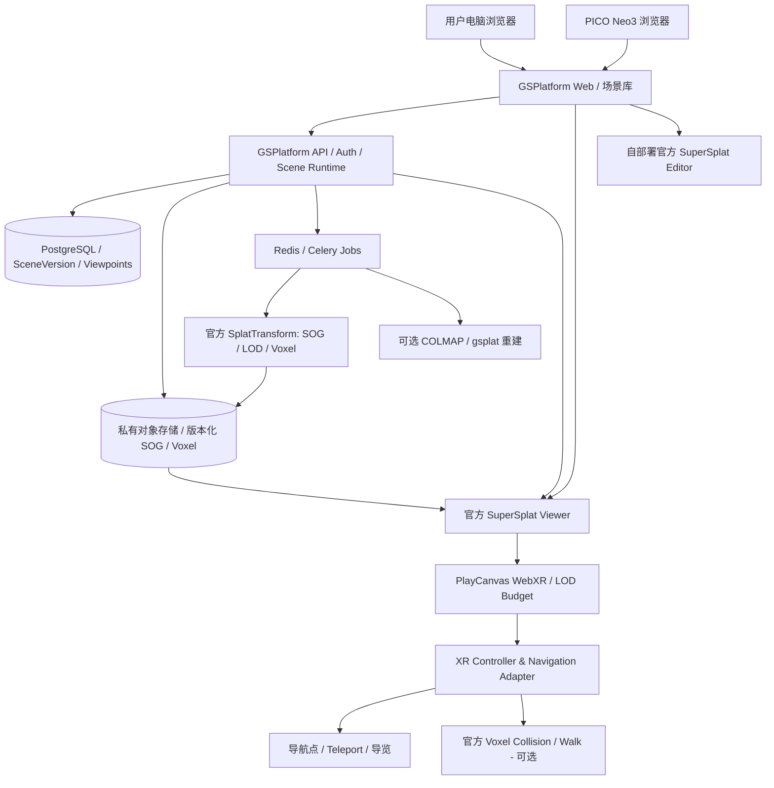

# GSPlatform：WebXR / PICO Neo3 / PlayCanvas 一体化平台总体实施方案

> 版本：V1.0｜2026-10-11  
> 项目：[`LiuLiShenShe/GSPlatform`](https://github.com/LiuLiShenShe/GSPlatform)  
> 审阅代码基线：`5421879b78135dc8a312ff5929057f0da8f95022`（审阅时 `origin/main`）  
> 目标设备：**PICO Neo3**；第一交付形式：**头显浏览器直接访问 HTTPS 网站并进入 WebXR**。  
> 决策属性：**主计划 / 后续开发阶段的需求权威来源**。实际施工应以当时最新 HEAD、锁定的官方依赖和真实 PICO 验收为准。

## 0. 一句话目标与优先级

**我们要做的首先是一个类似“知天下”的独立 3D Gaussian Splatting（3DGS）Web + VR 平台，而不是先做农业表型管理系统。**

用户把已经重建完成的 **Gaussian PLY** 上传到 GSPlatform：后台调用 PlayCanvas **官方 SplatTransform** 生成压缩 SOG 或 Streamed SOG（分块与 LOD），由 **官方 SuperSplat Viewer / PlayCanvas Engine** 在 PC 上高画质显示、在 **PICO Neo3** 上使用 WebXR 和受限 Gaussian 渲染预算显示；用户可通过摇杆自由移动、转向，通过自己布设的**导航点快速跳转**，并可查看热点、进入 VR 菜单、切换场景。

我们的平台负责：上传、登录、权限、场景目录、导航点与漫游路线、任务和版本、资源服务、用户交互、部署和分享。**通用 3DGS 的转换、LOD、渲染、碰撞体素生成、Gaussian 编辑优先复用 PlayCanvas 官方开源组件。**

**立即优先级：真实上传场景的 PICO WebXR 闭环 → 摇杆移动与节点传送 → PlayCanvas 碰撞 / Walk → VR 内交互 → 知天下式作品平台 → 稳定上线。农业业务最后扩展。**

---

## 1. 最终产品需要具备的功能

### 1.1 上传与自动处理（必须）

1. 用户登录网页，选择 Gaussian PLY（以及已有受支持的 SOG/SPLAT/Streamed SOG 包），填写名称、封面、可见性和必要的处理选项。
2. 大文件可断点续传、校验哈希、查看处理状态；上传成功不等于发布成功。
3. GSPlatform Worker 调用**官方 `@playcanvas/splat-transform`** 处理格式、压缩、必要的 LOD Decimate、分块与 `lod-meta.json`；直接上传的合法流式包不做无意义的重复转换。
4. 发布为受保护、不可变的 SceneVersion；`content.url` 指向当前版本的 SOG 或 `lod-meta.json`；已有模型不因后续调整被覆盖。
5. 提供桌面 Viewer、正式 XR 链接以及可分享作品页。转换故障可以安全重试，不损坏源文件或旧版资产。

### 1.2 电脑浏览与头显 XR（最高优先级）

- 电脑浏览器：官方 Viewer，优先 WebGPU，高画质，旋转 / 缩放 / Fly / 保存视角 / 注释 / 全屏。
- PICO Neo3：**不安装原生 App 也能经头显浏览器打开自有 HTTPS 网站**；从 `/xr/:sceneId` 点击“进入 VR”，真实双目立体和 6DoF，能退出与重新进入。
- 同一 SceneVersion 的流式资源供桌面与 XR 消费，按设备能力实行不同**渲染预算 / 分辨率 / LOD 策略**，避免 PICO 一次性绘制全部原始 Gaussian。
- 跳转到远距离位置时正确渐进加载附近 LOD，允许短时粗糙化，但不能黑屏、失去头部追踪或持续卡死。

### 1.3 VR 导航与手柄（最高优先级）

| 输入/操作 | 用户目标 | 实施注意 |
|---|---|---|
| 头部转动与身体小幅平移 | 6DoF 自然查看 | WebXR 真机，不能替换或硬写 HMD 位姿 |
| 左摇杆 | 连续前后/左右移动 | 头部朝向相对；支持速度、死区；先完成 Fly |
| 右摇杆左右 | 30°/45° 等舒适转向（Snap Turn） | 冷却、回中再触发，防止连转；角度可配置 |
| A/B 或菜单选择 | 上一个 / 下一个导航点 | **实际 PICO 按键映射以设备检测和真机测试为准** |
| 控制器射线 / 扳机 | 选择节点 / 热点 | 不能依赖沉浸会话外的 HTML 点击 |
| 节点传送 | 立即到达指定位置、朝向 | 操作 XR Rig / 官方受支持导航入口，不能直接改 HMD camera |
| VR 菜单 | 节点列表、退出 XR、当前场景信息、画质选项 | 必须渲染在 VR 空间中，普通网页 Overlay 不够 |

需要区分：**Fly（无碰撞自由移动）**、**Teleport（保存节点瞬移）**、**Walk（有物理尺度和碰撞的地面行走）**。前两者应先可用，不得以“未生成碰撞”为由把全部导航禁用。

### 1.4 导航点与漫游系统（必须）

- 在电脑网页的三维场景编辑页添加导航点、命名、删除、排序、隐藏；保存当前位置和朝向。
- 场景可有“入口”“通道”“观察点 A”“观察点 B”等多个节点。
- 用户戴上头显后，用按键切换节点，或在 VR 节点列表中选择，或通过射线点选场景中的标记传送。
- 传送流程提供淡出→定位→淡入，避免突兀位姿跳变；目的地不可用时明确提示。
- 支持“路线/导览”作为节点的有序集合。首版只需**手动跳点**；自动巡游、路径寻找和迷你地图可随后扩展。
- 将**观察视角（camera/viewpoint）**与**可到达的导航位置（XR destination）**的语义区分清楚。优先复用现有 `SceneViewpoint`，如需不同的落脚点、可行走性或目标版本等语义，才增加少量专用字段或关联表，不复制整套 Viewpoint API。
- 导航节点坐标与 SceneVersion / 世界变换绑定；几何编辑后若无法证明空间关系仍有效，要标记待重新确认，而不是静默使用旧坐标。

### 1.5 官方碰撞与 Walk（需要，但不能阻塞前述功能）

**PlayCanvas 确实已经实现了碰撞体素生成，GSPlatform 不需要自己编写碰撞算法。**

两种官方交付形式须区别：

- **SuperSplat Studio 在线平台**：资产页面可以直接点击 **Generate Voxel Collision**，选择 Indoor / Outdoor / Object 和 seed 等选项。这是官方托管产品的用户界面，**不是可直接搬回自有服务器的完整 SaaS 后台**。
- **开源、自托管方案（我们的方案）**：Worker 调用**官方 SplatTransform CLI**，生成 `.voxel.json` + `.voxel.bin`，按需要再生成 `collision.glb`；官方 SuperSplat Viewer 能消费体素资源以进行 Walk/碰撞。GSPlatform 仅维护触发策略、Job、权限、版本绑定、校验和下载。

推荐业务规则：

1. 普通上传**先发布视觉场景**，碰撞不作为发布成功的必要条件。
2. 可以在场景设置中“生成碰撞”，选择 Indoor / Outdoor / Object、seed、预设分辨率；由官方 CLI 真正生成，失败保留日志并可重试。
3. 对明确需要漫游、**真实尺度已验证**且符合资源预算的环境场景，可提供**显式 opt-in 的自动碰撞**；不再对所有场景（例如盆栽对象）无条件构建。
4. 官方 SplatTransform 的 `--voxel-external-fill`（室内）、`--voxel-floor-fill`（室外）、`--voxel-carve` 与 `--collision-mesh` 仅在**本仓库锁定版本的 CLI `--help` 支持并经小场景验证**后使用。不要复制新文档参数到旧版 CLI。
5. Voxel 表示近似物理环境，**不是精确叶片或物体的几何真值**；场景原始 3DGS 坐标未校准米制时，不能把 Walk 当作真实物理行走。
6. 每次场景内容版本或影响碰撞的世界变换改变，都要检查 stale；旧碰撞不得冒充当前版本。
7. 大场景官方碰撞可能耗时很长、失败甚至资源不足。此时仍允许 **Fly + 导航点 Teleport + WebXR**。必要时先用经过验证的低成本环境代理碰撞/地面表示，而不是无限制重复给 1300 万 Gaussian 生成高精度体素。

### 1.6 参考知天下的平台功能（在 VR 核心完成后）

第一批：作品库、作品详情页、封面与基本信息、搜索和分类、作者页/我的作品、公开/私有/分享权限、桌面浏览、进入 VR、导航点和热点。  
第二批：精选/最新/热门、收藏、地图发现、场景导览、多个场景切换、截图、背景音乐与媒体信息。  
可选后续：上传视频/照片→云端重建任务、创作者社区、PICO 原生 App、农业数字孪生业务。

这属于**参考其产品体验**，不复制知天下的私有代码或假定其内部实现公开。

---

## 2. PlayCanvas 与 GSPlatform 的长期责任边界

| 领域 | 责任方 | 具体说明 |
|---|---|---|
| Gaussian 解码、压缩、SOG、Decimate、LOD/Chunks | **官方 SplatTransform** | 平台仅调用、校验、调度与保存结果 |
| Gaussian 渲染、桌面/WebXR、流式 LOD | **官方 SuperSplat Viewer + Engine** | GSPlatform 使用薄适配，不 fork 渲染器 |
| Gaussian 选择、裁剪、清理、PLY/SOG 导出 | **自部署官方 SuperSplat Editor** | 已接入，不重新发明编辑工具 |
| Voxel/GLB 生成 | **官方 SplatTransform** | 平台管理触发、seed、资源预算、Job/校验 |
| XR 输入、移动与传送 | **优先验证 PlayCanvas 官方 XR 脚本和 Viewer 公开 API** | 官方 `xr-navigation.mjs` 是 Engine Script，**不能未经验证就直接塞进现有 Viewer**；必要时仅写少量手柄—Rig 适配代码 |
| 作品、用户、场景、权限、分享 | **GSPlatform** | 独立网站与域名、自有存储和数据库 |
| 视角/导航点/路线、热点、VR 菜单 | **GSPlatform 业务 + PlayCanvas 通用 UI/输入基础** | 自有配置与交互，不重新开发 3DGS 引擎 |
| SceneVersion、上传、Job、故障恢复、数据安全 | **GSPlatform** | 不能因为官方云端有相似功能而删除 |
| COLMAP / gsplat 云端重建 | **GSPlatform 可选服务** | 保留已有能力，不阻塞头显平台 MVP |
| 植物表型、农业实例、时序 | **后续扩展** | 本轮不是优先建设内容 |

**重要边界**：PlayCanvas 官方 Viewer 提供 `setMoveInput` 等公开入口，但需要用锁定的 `@playcanvas/supersplat-viewer@1.35.0` 真正验证这些入口在**XR 会话**中对 Fly、Walk、Rig 的效果。不能仅凭桌面 `setMoveInput` 正常就宣布 PICO 摇杆支持已完成。

---

## 3. 截至当前 Git 的实际完成情况

审阅代码基线：`5421879b78135dc8a312ff5929057f0da8f95022`。下表区分“代码/隔离 E2E 验证”和“用户真实 PICO 硬件验证”。

| 模块 | 代码现状 | 当前真实缺口 |
|---|---|---|
| 断点续传、PLY 校验、发布 | 已实现 | 在新部署环境对**用户上传的新场景**做端到端验证 |
| 官方 SplatTransform、SOG、Streamed SOG、LOD | 已接入；已有约 1309 万 Gaussian 的场景已成功转换为 259 块流式 SOG | 头显上稳定运行与近远景 LOD/性能尚未实测 |
| 官方桌面 Viewer | 已接入、已有真实桌面加载报告 | 正式 HTTPS 部署及真实 PICO 网络条件 |
| `/xr/test` 和正式 `/xr/:sceneId` | 已采用官方 Viewer；此前 `local-garden` 曾在真实 PICO 上进入 immersive VR 并看到 6DoF | **新上传场景**的 PICO 端到端测试；多次进入/退出、黑屏和掉帧测试 |
| Gaussian 渲染预算 | 官方 Streaming / Performance 路线已接入，官方通用移动/XR预算存在 | PICO Neo3 的**实际适合预算**尚未确定；不能直接把 1M/2M 当硬件通过值 |
| 官方 Collision 生成 | CLI voxel/GLB 真实小场景测试完成；Job、版本、安全等存在 | 当前处理策略默认 `MANUAL_ONLY`；1300 万场景历史碰撞有超时，可靠大场景 Walk 未验证 |
| 保存视角 | `SceneViewpoint`、`ViewpointPanel`、桌面定位已有 | 正式 XR 中的节点按键切换、空间传送和节点菜单尚未形成验收闭环 |
| 旧 `apps/xr-viewer` 摇杆导航 | 历史 Phase 14 有实施记录 | **SSV-09 已删除旧生产 XR 子项目**；不能把历史的单测 PASS 当现在运行着的功能 |
| XR 手柄移动和 Snap Turn | PlayCanvas 提供官方 XR 导航脚本，现有 runtime 公开 `setMoveInput` | 需要对锁定版本、XR Rig、真实 PICO Controller 输入与转向逐项集成测试 |
| VR 内热点媒体 | 有网页版标注与媒体 Overlay | 当前普通 HTML Overlay **不能在 immersive VR 视野内作为空间菜单使用**；需 VR 内面板 |
| 自部署 SuperSplat Editor | Phase 3 已完成软件开发与隔离环境验收 | 实际独立服务器部署与浏览器权限验证 |
| 正式部署 | Git 代码已提交 | 数据库迁移、服务/Worker/Editor/HTTPS 同步更新和实机验收仍待做 |

**不要重新做**：Phase 1–3 的架构收口、编辑器、上传重构、转换 recipe 研究、Gaussian 编码、自己写体素碰撞等。把开发资源集中到上述真实 VR 功能缺口。

---

## 4. 最终系统架构

原则：**唯一 Viewer、唯一 Runtime Descriptor、唯一授权资产服务、唯一 SceneVersion 真相源**。桌面和 XR 对同一当前版本获取统一内容 URL，仅渲染器/性能/交互模式不同。

---

## 5. 分阶段开发与真实验收（新的权威顺序）

### VR-00：当前版本部署和启动基线（先做）

**目标**：将已完成的 Web、API、DB migration、CPU/GPU Worker、官方 Editor、HTTPS 部署在一套协调的环境中，避免“GitHub 最新但服务器仍是旧进程”。

**工作**：
- 读取真实环境的 `git rev-parse HEAD`、Alembic head、Worker 队列和 CLI 版本。
- 迁移前数据库备份；现有 Phase 2/3 迁移按顺序执行，不能在旧数据库启动新 API。
- API / Web / Worker / Editor / HTTPS 启动和健康检查；端口和私有资源权限检查。
- 优先用可靠启动管理器；若一键脚本尚未实装，不在本阶段重新写完整管理框架，可先采用已有部署脚本。

**PASS**：打开 PC 作品页、正式 XR 页面、旧作品；私有访问策略正常；可以新建小型测试上传；HTTPS 在 PICO 浏览器可访问。

### VR-01：真实 PLY → SOG → PICO XR 完整闭环（最高优先级）

**目标**：证明上传后的 Gaussian 在真实头显里可用、流式加载确实工作，并有合理的性能策略。

**测试层级**：
1. **小型真实 PLY（约 2 万～10 万）**：基本上传、发布、WebXR 与立体显示。
2. **中型 PLY（约 50 万～100 万）**：检查 SOG / Streamed SOG 转换和 WebXR LOD 加载。
3. **现有 1300 万级农业场景**：先复用已发布的合法 259 Chunk 资产进行**只读** WebXR 负载验证；不重转、不重建碰撞、不修改历史版本。

**性能策略**：
- 继续用官方 Viewer / 官方 Streamed SOG。优先从 PICO 上**保守的渲染预算**入手，实际试验例如 **25 万 / 50 万 / 100 万 Gaussian**（实验档位，不是承诺支持值），再比较效果与 FPS。
- 保留动态 LOD 与距离优先的合理策略；注意仓库当前 PlayCanvas 2.22.4 与新版官方文档默认 LOD 模式可能不同，变更前验证锁定版本。
- 评估适当降低渲染分辨率、Performance Mode、抗锯齿/像素填充成本；不得为追求表面 FPS 盲目关闭 LOD 校验或破坏画质。
- 记录加载时长、真实已显示 Gaussian、Chunk 请求、内存/崩溃迹象、FPS/帧时间、近处细节、头部移动稳定性、XR 会话重进。

**PASS**：PICO Neo3 在浏览器访问 `https://自有域名/xr/<真实Scene>` 能看到上传的内容、正确双眼显示并保持 6DoF；至少 3 次退出重进；在代表性模型中没有持续黑屏或不可恢复崩溃。**具体性能阈值由真机目标刷新率和测试记录最终确定**，不能只看桌面模拟。

### VR-02：PICO 摇杆移动、转向和舒适交互

**目标**：在当前官方 Viewer XR runtime 中支持真实 PICO 控制器，且不复活已删除的 `apps/xr-viewer`。

**优先复用**：
- 当前 `SuperSplatRuntime.setMoveInput(x,z)` / Viewer 的公开输入接口；
- PlayCanvas Engine 官方 `xr-navigation.mjs` 的公开实现思路，**先确认其在现有 Viewer 创建的 App / Rig 中能否合法接入**。如果不能直接集成，只做小而清楚的 Controller→Rig 适配层，不复制完整引擎或历史自研碰撞 Raycaster。

**实现**：输入源识别、PICO 真机轴/按键表、deadzone、左摇杆相对头朝向平移、右摇杆 Snap Turn、舒适速度和转向档位、暂停/菜单时停止移动、退出 XR 后清理订阅。禁止直接改写头显追踪的 Camera 世界变换。

**PASS**：真实 PICO 中前进、后退、横移、右摇杆转向都符合操作预期；放开摇杆立即停；至少 10 分钟连续操作无异常跳变；不破坏 6DoF 和进入/退出 XR。

### VR-03：导航点创建、路线与 VR 快速跳转

**目标**：把网页已保存的观察点变为真实 XR 可到达的导航点。

**首先复用**：`SceneViewpoint`、`ViewpointPanel`、已有桌面 `selectViewpoint` 和场景 Runtime Descriptor。

**差异检查**：Web 桌面相机切换不等于 XR Rig 瞬移；需要做坐标、朝向和头显相对高度适配。对于实际需要的“导航节点”可扩充 `arrivalPose`、`sceneVersionId`、`worldTransformHash`、`orderIndex`、`enabled`、`nodeType` 等，但不要未经分析重复建表。

**功能**：网页场景中保存并排序 ≥5 个节点；可指定入口节点；PICO 中 A/B 或可验证的对应操作切节点；VR 列表选点；可选的激光射线点选；淡出→Rig 跳转→淡入；有序路线用于手动导览。

**PASS**：真机对 5 个不同节点连续切换 20 次，抵达方向和位置正确，头显身体追踪不被破坏；节点隐藏、改名、顺序和权限真实生效；编辑后空间失效逻辑正确。

### VR-04：PlayCanvas 官方碰撞生成和 Walk（独立功能关卡）

**目标**：用户无需自己提供网格，就可以在 GSPlatform 中选择“构建碰撞”，平台用官方 SplatTransform 生成可供 Viewer 使用的碰撞资产；具备真实尺度的环境场景支持物理 Walk。

**做法**：
- 复用已完成的 `workers/collision/splat.py`、Collision Job / lease / fencing / Asset serving，不新建碰撞算法。
- 网页设置提供 **Indoor / Outdoor / Object**、seed、生成状态、失败解释、重建、版本 stale 信息。
- 生成 `.voxel.json` + `.voxel.bin`，可选 GLB；先在**小型标定环境**实际验证，再评估复杂场景资源预算。
- 单独区分“碰撞产物生成成功”和“Walk 已被授权并实际有效”：Walk 需要米制标定、版本匹配以及 runtime `hasCollision`/`walkAllowed` 成立。
- 仅在明确配置且条件满足时自动发起 Collision，不用全场景默认自动生成。任何碰撞失败不得阻塞桌面查看、Fly、节点跳转或 XR。

**PASS**：小型真实环境从上传→手动或合规自动碰撞→官方 Viewer Walk 验证成功；碰撞版本匹配、地面行走和墙面阻挡合理；未校准时明确禁用物理 Walk 但保留 Fly 和 Node Teleport。大型场景如果超出预算，透明显示不可用原因而不无限循环重建。

### VR-05：VR 内菜单、信息热点与完整漫游体验

**目标**：头显内实际能用的交互体验，而不只是 PC 上存在 HTML 面板。

**功能**：
- 世界空间 VR 菜单：导航点列表、当前场景、画质/移动模式、退出。
- 控制器射线选择场景热点/导航点，支持文字、图片（可选再做视频/音频）。
- 与现有 `SceneAnnotation`、Experience Settings 热点和媒体资产复用；Web 页面 2D Overlay 继续可用，沉浸 VR 内则提供 VR 原生 Panel。
- 优先复用 PlayCanvas 官方 XR Menu、Controllers 能力，但必须验明与官方 SuperSplat Viewer 的兼容路径。

**PASS**：无需退出 XR 就能完成查看热点、选择节点、显示/关闭菜单、返回入口；文字清楚，射线命中可用，媒体内容不会造成大幅掉帧。

### PLATFORM-01：知天下式独立作品平台

**目标**：完成网站用户可以直接使用的内容平台工作流。

**优先顺序**：作品发布和列表→作品详情→作者与分类搜索→封面/缩略图→私有/公开/分享→“进入 VR”二维码或短链接→精选/热门/最新→收藏→地图/导览等。保留现有云端重建作为可选入口。

**原则**：先复用已有 Web/UI/API/权限和分享，再做缺口；不要复制知天下页面样式或未公开代码。

**PASS**：一个新用户能从浏览作品开始，在自己的账户上传/管理、电脑浏览、通过分享链接（权限正确）在 PICO 进入 XR、在场景内导航并退出。

### RELEASE-01：正式域名、真实 PICO 压测与上线验收

**目标**：自有域名、HTTPS、数据库/Worker/静态资源稳定运行，真实头显能长期使用。

**工作**：
- 稳定域名和 HTTPS，而不是将随机 Quick Tunnel URL 作为生产方案。
- 验证 Redis/Celery/PostgreSQL、Worker 异常恢复、独立 Editor、SOG 路径与缓存、授权 Chunk、Range、HTTPS mixed-content。
- PICO 真机执行小/中/大场景性能测试，保存 FPS、帧时间、加载时间、Gaussian 预算、Chunk 请求与崩溃日志。
- 确认安全策略：私有作品在未授权头显不可访问；分享链接按实际权限工作；不暴露 staging/原始大文件。
- 执行回归：上传、发布、编辑版本、节点、XR、碰撞、私有权限、退出/重入、持续运行。

**PASS**：真实 PICO 使用固定 HTTPS 入口，端到端功能和故障恢复满足书面验收矩阵；没有未披露的主要阻断问题。

### AGRI-01：农业数字孪生（后续，不作为当前主线）

在 VR 平台稳定可用后，再扩展单株、作物行和温室管理、植物实例、测量数据、表型和多时相模型绑定。它**不得阻塞 VR-01 至 RELEASE-01**。

---

## 6. 最优先的首个 Sprint（下一次 Claude Code 应做什么）

只做 **VR-00 + VR-01**，先取得真实 PICO 的正式业务链路结果。

1. 读取 HEAD、数据库迁移状态、现有启动脚本及相关健康检查，确保 API/Web/Worker/HTTPS 为同一版本。
2. 在开发数据库创建**新的小型真实 Gaussian PLY**，通过网页真实上传、处理并发布；不得拿静态测试 SOG 代替上传链路。
3. 从 `/scene/<slug>` 检查桌面 Viewer 和 `content.url`，再从**同一 slug** 的 `/xr/<slug>` 在 PICO 浏览器点“进入 VR”。
4. 真机检查：双眼、6DoF、退出重进、内容加载、相对场景空间定位、持续流式分块、Performance Mode。
5. 测试中型资产；对已有 13M 场景**只读**做 XR 加载/预算压力试验，不修改已发布文件、不重建碰撞。
6. 将真机的成功/失败、PICO 浏览器版本、控制器输入检测情况、输出 URL、Gaussian 预算与帧时间写入报告。
7. 只有 VR-01 通过，再开 VR-02 输入层实施；**不要在第一轮顺便开发农业表型或全面重构数据库**。

### 需要保留的已知技术约束

- 单一生产 Viewer：`@playcanvas/supersplat-viewer@1.35.0`；XR WebGL，Desktop WebGPU/回退 WebGL。
- 当前官方 SplatTransform 锁定版本：`3.3.3`；新文档 CLI 参数必须以此版本核验。
- 历史 `apps/xr-viewer` 已在 SSV-09 中删除。Phase 14 的方案仅作为控制意图/测试参考，不恢复成第二个生产 Viewer。
- 已有 Viewpoint/Annotation/Picking/SceneVersion 资产和代码应优先复用。
- `collisionPolicy` 目前默认 `MANUAL_ONLY`；无真实尺度不能把物理 Walk 设为 PASS。
- 新建/修改任何 XR 菜单、导航点，不得绕过 SceneAccessPolicy、当前版本或 stale 状态。

---

## 7. 最终验收矩阵（先软件，后 PICO 真机）

| 验收项 | 软件自动测试 | 必须 PICO 真人验收 | PASS 条件 |
|---|---|---|---|
| PLY→SOG→SceneVersion | 是 | 否 | 当前资产格式、LOD、校验和正确，Viewer 200/加载成功 |
| 真实上传场景进入 XR | 辅助 | **是** | 真正进入 immersive-vr，双眼显示，6DoF 正常 |
| 大场景 Streamed SOG | 是 | **是** | 分块动态加载，预算稳定，没有持续黑屏/卡死 |
| 性能档位 | 是 | **是** | 实测三种预算的帧时间与画质，确定 PICO 可用默认档 |
| 左摇杆自由移动 | 可模拟输入 | **是** | 方向正确、头向相对、无残余漂移 |
| 右摇杆 Snap Turn | 数学与事件 | **是** | 一次触发一次转向，无无限旋转 |
| 保存、删除和排序节点 | 是 | 否 | DB 及 Web UI 正确 |
| 节点瞬移与 A/B 切换 | 单元与浏览器 | **是** | ≥5 个节点、连续 20 次准确切换，姿态稳定 |
| 官方 Voxel/GLB 生成 | 真实 CLI | 否 | 有效产物、版本绑定、授权访问 |
| 碰撞 Walk | 软件辅助 | **是** | 已校准场景有合理地面和阻挡，未校准时安全禁用 |
| VR 内菜单与热点 | 软件辅助 | **是** | 沉浸状态下实际可见、可操作 |
| 私有作品/分享 | 是 | **是** | 未授权 401/403/404，授权可用，不泄漏资源 |
| HTTPS 与生产部署 | 是 | **是** | 稳定域名真实可访问，所有服务一致、可重启 |

**门禁规则**：软件测试通过不能代替真实头显 PASS。遇到非阻断问题可分级，但不能把未实现的手柄控制或碰撞传送列为已完成。

---

## 8. 不做的事（防止再次跑偏）

1. **暂不进入农业项目/株高冠幅/叶片表型的大规模开发**，先让 VR 平台跑起来。
2. 不再自己写 Gaussian 编码、SOG、LOD Tree、Renderer、Voxel 体素化、Gaussian 编辑器。
3. 不复活旧 `apps/xr-viewer`，不另开第二套 XR 引擎。
4. 不因为碰撞失败就阻止 Fly、节点瞬移或场景 XR 加载。
5. 不把 SuperSplat Studio 的托管生成按钮理解为免费自部署的后端 API；自部署使用官方开源 CLI。
6. 不在未授权条件下修改现有 1300 万 Gaussian SceneVersion 或自动重复转换大文件。
7. 不直接操作 WebXR HMD Camera 位姿；Rig/导航按官方公开接口与实际兼容性实现。
8. 不认为 WebGL/XR 画面能出现就已经具备摇杆、导航点、VR 菜单。
9. 不凭官方的通用 1M/2M Gaussian 预算推断 PICO Neo3 一定跑得流畅；以实测为准。
10. 不把生产部署当成 Git push 的自然结果；迁移、服务启动和头显验收独立进行。

---

## 9. 开发时推荐的文件与接口检查入口

| 领域 | GSPlatform 当前入口 / 需检查内容 |
|---|---|
| WebXR 正式页 | `apps/web/src/pages/XRViewerPage.tsx` |
| XR 状态和生命周期 | `apps/web/src/features/viewer-official/useSuperSplatXR.ts` |
| 官方 Viewer 薄适配 | `apps/web/src/scene-runtime/SuperSplatRuntime.ts`：`startVR`、`endXR`、`setMoveInput`、`selectViewpoint` |
| 场景内容 URL / 碰撞 URL | `apps/api/app/services/scene_runtime.py`、前端 `descriptorResolver` |
| 观察点与编辑 | `apps/api/app/db/models/scene_viewpoint.py`、`apps/web/src/features/authoring/ViewpointPanel.tsx`、`SceneAuthoringPage.tsx` |
| 转换与发布 | `workers/pipeline/convert_scene.py`、`splat_transform_adapter.py`、`artifact_validator.py`、`workers/tasks/publish_scene.py` |
| 官方碰撞 | `workers/collision/splat.py`、`workers/tasks/build_collision.py`、`apps/api/app/services/collision_policy.py` |
| VR 菜单与热点 | 现有 Annotation / Experience Settings / Viewer 交互，配合官方 XR 脚本能力审查 |
| 历史控制需求 | `docs/Phase 14：XR Navigation & Viewpoints.md`（**历史规格，不是当前生产代码**） |
| 旧 Viewer 清理说明 | `docs/reports/SSV_09_REPORT.md` |

---

## 10. 官方资料与产品参考（2026-10-11 核验）

1. PlayCanvas — [Collision Mesh Generation / SplatTransform CLI](https://developer.playcanvas.com/user-manual/splat-transform/collision/)：Voxel、GLB、室内/室外、Carve 和 seed。
2. PlayCanvas — [SuperSplat Studio Collision](https://developer.playcanvas.com/user-manual/supersplat/studio/collision/)：托管平台的 Generate Collision 操作与物理尺度要求。
3. PlayCanvas — [SuperSplat Viewer](https://developer.playcanvas.com/user-manual/supersplat/viewer/)：独立 Viewer、Walk、WebXR、Annotations。
4. PlayCanvas — [Generating Streamed SOG](https://developer.playcanvas.com/user-manual/splat-transform/streamed-sog/)：LOD 0 为最高精度，分块输出。
5. PlayCanvas — [Streaming & Performance](https://developer.playcanvas.com/user-manual/supersplat/streaming/)：通用移动/XR预算与 Progressive Loading。
6. PlayCanvas — [3DGS Performance](https://developer.playcanvas.com/user-manual/gaussian-splatting/building/performance/)：渲染预算、填充率、LOD 性能策略。
7. PlayCanvas — [XR Navigation Engine Script](https://github.com/playcanvas/engine/blob/main/scripts/esm/xr/xr-navigation.mjs)：控制器平滑移动、Snap Turn、射线传送（**需验证与当前官方 Viewer 兼容性**）。
8. PlayCanvas — [Web Components XR](https://developer.playcanvas.com/user-manual/web-components/xr/)：XR Rig、XR Navigation、Controllers、Menu 和安全上下文。
9. 知天下 — [3DGS 在线平台](https://3d.explorerglobal.cn/)及[官方网站](https://explorerglobal.cn/)：平台作品、发布、社区、地图和 XR 产品参考。
10. GSPlatform — [GitHub](https://github.com/LiuLiShenShe/GSPlatform)：当前代码事实以仓库最新 HEAD 为准。

---

## 11. 最终产品验收定义（Definition of Done）

一个第一次使用 GSPlatform 的用户应当能够：

1. 用自己的账号上传一份已经训练好的 Gaussian PLY。
2. 无需手工运行命令，等待官方 SplatTransform 完成自动压缩、Streamed SOG / LOD 构建和版本发布。
3. 在 PC 网页中查看高质量模型，并保存若干导航点与名称。
4. 戴上 PICO Neo3，打开同一个作品的 HTTPS XR 链接，点击进入 VR。
5. 在 XR 中正确获得 6DoF 双目沉浸体验；大场景按需加载 LOD，而非绘制全部源 Gaussian。
6. 用手柄左摇杆自由移动、右摇杆转向；通过按键、菜单或射线在导航点之间快速传送。
7. 在头显内打开菜单或热点说明；如场景具有合规官方碰撞产物与标定，还可选择 Walk。
8. 退出 XR、重新进入，或者返回作品列表选择下一个场景。
9. 用户的场景、权限、导航点和资源保存在自己的 GSPlatform 服务器上，而不是依赖知天下或 superspl.at 的托管数据。

**达到这九步才是这轮产品主目标完成。农业表型、植物实例和时序数据作为后续应用加在它上面，而不是先于它。**
