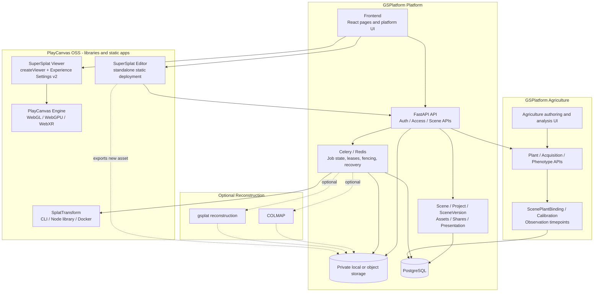

# GSPlatform PlayCanvas-First Integration Architecture

**Audit:** PC-INTEGRATION-01
**Date:** 2026-10-11
**Repository:** `/fj/GSPlatform`
**Baseline HEAD:** `b14d1ab8e2747197749af82b676e12bd69ce0d38`
**Branch:** `main`
**Scope:** Read-only architecture audit and implementation planning. No business code, database, dependency, service, job, or user asset was changed.

## 1. Executive Summary

GSPlatform already uses the official SuperSplat Viewer as its production browser runtime. The current web path is:

```text
React page
  -> SceneRuntimeDescriptorV1
  -> Experience Settings v2 adapter
  -> SuperSplatRuntime
  -> @playcanvas/supersplat-viewer createViewer()
  -> PlayCanvas Engine / WebGL or WebGPU / WebXR
```

That is the correct strategic direction. The platform should not create a second Gaussian renderer, file decoder, SOG implementation, LOD algorithm, collision algorithm, camera engine, or XR runtime.

The platform must continue to own the surrounding system that PlayCanvas does not provide as a self-hosted product:

- identity, authorization, share links, project/work catalog, and private asset access;
- resumable upload, server-owned staging, checksums, manifests, immutable `SceneVersion`, and atomic publication;
- Celery job orchestration, leases, execution-generation fencing, retries, recovery, and observability;
- scene presentation and agriculture-domain data;
- optional COLMAP/gsplat reconstruction;
- deployment, storage, domains, backups, and integration APIs.

The principal architectural decision is therefore **integration and ownership correction**, not a renderer rewrite:

1. Keep the official Viewer as the only production 3DGS runtime.
2. Keep SplatTransform as the only general-purpose conversion and collision engine, behind a small platform adapter.
3. Simplify `convert_scene.py` by separating conversion policy from official tool invocation, while preserving recipe identity, staging, validation, verification, idempotency, and publication fencing.
4. Make collision generation policy-driven and calibration-aware. Do not make every upload pay for collision generation.
5. Integrate SuperSplat Editor as a separately deployed, self-hosted official application with file/session boundaries. Do not copy the Editor into `SceneAuthoringPage` and do not treat its limited iframe hooks as a general embedding API.
6. Build agriculture entities and time-series measurements beside the Gaussian asset graph, never inside a Gaussian file or Viewer settings schema.

The 13,090,324-Gaussian acceptance report is consistent with this boundary: Streamed SOG publication and desktop loading succeeded; automatic collision timed out after 600 seconds; the collision failure did not invalidate the published SceneVersion. The timeout is a collision policy/performance issue, not evidence that the SOG conversion or Viewer path is invalid.

## 2. Evidence Rules and Audit Limitations

Every conclusion in this document is labelled by evidence state:

- **VERIFIED** — observed in the current repository, lockfile, tests, reports, or cloned source at a recorded commit.
- **DOCUMENTED** — stated in an official PlayCanvas documentation page or official repository source.
- **PROPOSED** — target architecture or future implementation decision; not present today.
- **NOT VERIFIED** — requires a future test, hardware run, or upstream contract confirmation.

The official sources were read directly and, where useful, from shallow clones recorded during this audit. The current project lockfile was not changed.

The required Bocha search endpoint returned HTTP `403` for the audit queries. This is recorded rather than hidden. The official PlayCanvas pages and repositories were still reachable directly, and Context7 returned the official documentation and repository records. No conclusion below is presented as a Bocha result.

The audit did **not** stop or alter Celery workers, cancel jobs, execute a collision build, re-convert the large PLY, change database state, or access user-private assets beyond repository documentation and source inspection.

## 3. Baseline and Current Version Lock

### 3.1 Git and worktree

**VERIFIED** at the start of the audit:

```text
pwd                 /fj/GSPlatform
branch              main
HEAD                b14d1ab8e2747197749af82b676e12bd69ce0d38
origin/main         b14d1ab8e2747197749af82b676e12bd69ce0d38
initial worktree    clean
```

The ten most recent commits were conversion, collision fencing, upload recovery, and acceptance-report changes. The audit treats the current checkout as authoritative rather than assuming the supplied historical HEAD is still current.

### 3.2 Locked package versions

**VERIFIED** from `apps/web/package.json`, `apps/viewer/package.json`, and `pnpm-lock.yaml`:

| Component | Current project location | Locked version | Current use | Audit consequence |
|---|---|---:|---|---|
| `@playcanvas/supersplat-viewer` | `apps/web/package.json` | `1.35.0` | Production web runtime | Public Viewer API decisions must be tested against 1.35.0, not only current upstream. |
| `playcanvas` | `apps/web/package.json` | `2.22.4` | Production web runtime | Desktop and XR renderer behavior is pinned to the project lock. |
| `@playcanvas/splat-transform` | `apps/viewer/package.json` / worker pnpm path | `3.3.3` | Worker CLI invocation; legacy app dev dependency | Conversion and collision behavior is pinned to 3.3.3. |
| `playcanvas` | `apps/viewer/package.json` | `2.22.0` | Frozen legacy fork dependency | This fork is not the production renderer. |

**DOCUMENTED but not current project versions:** the official repositories inspected during the audit were Viewer `1.37.0` at commit `cd0e316e397929ffa87abd4833f73f8a0bd1fd2b`, SplatTransform `3.10.1` at commit `45931669547a7c70cbc44d2657749f8a56e5533c`, SuperSplat Editor `3.5.2` at commit `f2a1b4975b4766e0ee0c95e63c2737dc2ecb6e5b`, and Engine `2.24.0-beta.8` at commit `ad9ac93d9718c63cf1a861a5925b6145c11ca22b`.

Those upstream versions are evidence of available source, not an upgrade recommendation. Phase 1 performs no dependency upgrade. Phase 2 or later must create a compatibility branch, run the project acceptance suite, and make an explicit upgrade decision.

## 4. PlayCanvas Official Ecosystem and Boundaries

### 4.1 Capability matrix

| Official component | Open source or hosted | Self-deployable | Core capability | GSPlatform use | Evidence |
|---|---|---:|---|---|---|
| SuperSplat Viewer | Open source, MIT | Yes | Gaussian loading/rendering, camera interaction, annotations, settings, collision loading, Walk, WebXR, WebGL/WebGPU selection | Production runtime through `@playcanvas/supersplat-viewer@1.35.0`; host owns platform chrome and descriptor delivery | **DOCUMENTED:** [Viewer manual](https://developer.playcanvas.com/user-manual/supersplat/viewer/), [embedding](https://developer.playcanvas.com/user-manual/supersplat/viewer/embedding/), [source](https://github.com/playcanvas/supersplat-viewer) |
| SuperSplat Editor | Open source, MIT | Yes, as a built web application | Local Gaussian import, editing, filtering/cleaning, and export | Future standalone editor deployment; not copied into React | **DOCUMENTED:** [Editor repository](https://github.com/playcanvas/supersplat), [SuperSplat overview](https://developer.playcanvas.com/user-manual/supersplat/) |
| SplatTransform | Open source, MIT | Yes; Node/CLI/library/Docker | PLY/SOG/Streamed SOG/SPZ/SPLAT/KSPLAT/LCC/GLB/CSV/HTML conversion, LOD, filtering, statistics, voxel/collision outputs | Worker conversion and collision engine behind a pinned adapter | **DOCUMENTED:** [library](https://developer.playcanvas.com/user-manual/splat-transform/library/), [CLI](https://developer.playcanvas.com/user-manual/splat-transform/cli-reference/), [Streamed SOG](https://developer.playcanvas.com/user-manual/splat-transform/streamed-sog/), [Docker](https://developer.playcanvas.com/user-manual/splat-transform/docker/), [source](https://github.com/playcanvas/splat-transform) |
| PlayCanvas Engine | Open source, MIT | Yes, as an npm/library dependency | WebGL2, WebGPU, Gaussian rendering primitives, scene graph, input, WebXR | Indirect dependency of Viewer and future agriculture overlays; platform must not fork its renderer | **DOCUMENTED:** [Engine repository](https://github.com/playcanvas/engine) |
| Experience Settings | Open-source Viewer JSON contract | Yes | Settings v2 for camera, background, post effects, annotations, tonemapping, and related experience presentation | `experienceAdapter.ts` maps the platform descriptor to official settings and validates limits | **DOCUMENTED/VERIFIED:** [Experience Settings](https://developer.playcanvas.com/user-manual/supersplat/studio/experience-settings/); `apps/web/src/scene-runtime/experienceAdapter.ts` |
| SuperSplat Studio | Hosted `superspl.at` product | No as the same hosted service | Curates a published/uploaded splat into an Experience Settings JSON | Use only as an optional reference/service integration; not a self-hosted dependency | **DOCUMENTED:** [Studio](https://developer.playcanvas.com/user-manual/supersplat/studio/) |
| SuperSplat Manage | Hosted `superspl.at` product | No as the same hosted service | Account library, visibility, downloads, deletion, and scene management | Not a replacement for GSPlatform catalog, ownership, or ACLs | **DOCUMENTED:** [Manage](https://developer.playcanvas.com/user-manual/supersplat/manage/) |
| SuperSplat Publish API | Hosted API | No | Upload/publish and inspect scenes on `superspl.at` for an authenticated account | Optional future third-party adapter only; never the default asset store | **DOCUMENTED:** [API integrations](https://developer.playcanvas.com/user-manual/supersplat/api-integrations/) |

### 4.2 What is open source versus hosted

The official overview explicitly separates the MIT open-source core (Editor, Viewer, and SplatTransform) from hosted Studio, Manage, Explore, scene pages, and Publish API. The distinction matters:

- A self-hosted GSPlatform can run the Viewer, Editor build, SplatTransform CLI/library, and Engine without depending on `superspl.at`.
- A self-hosted GSPlatform cannot claim that Studio’s hosted management UI, Manage’s account library, or the Publish API is an internally deployable service merely because the Viewer reads the same settings JSON.
- The hosted Publish API may be an optional adapter, but it cannot replace GSPlatform’s ownership model, private storage, SceneVersion history, job recovery, or domain deployment.

### 4.3 Public API versus implementation access

**DOCUMENTED/VERIFIED public Viewer contract at the project’s locked line:** `createViewer()` accepts the content URL, settings, renderer selection, UI option, poster, and collision URL. The returned `ViewerHandle` exposes state, events, annotations, camera framing/reset, Walk, movement input, screenshot capture, annotation selection, XR start/end, and destroy. The Viewer source also exposes `app` as an escape hatch for hosts that need to reach deeper into the PlayCanvas application.

The escape hatch does not make every reachable object a stable contract. The current adapter uses several version-sensitive details:

- `handle.app.root.findByName('gsplat')` and the component’s `customAabb`;
- `app.stats.frame.gsplats`;
- internal entity/camera details for pose extraction;
- internal `.sse-*` CSS classes;
- mutation of the annotations array to emulate a missing `setCameraPose` API.

These are **NOT VERIFIED as stable upstream APIs**. They are acceptable as isolated compatibility code while pinned to 1.35.0, but they must not leak into pages or become a second rendering abstraction. Each such use needs a version contract test before a Viewer upgrade.

The Editor source contains limited iframe/postMessage hooks for “scene dirty” and “navigate home”; it does not document a general, stable React embedding API for importing files, controlling editor state, or exporting a version. Therefore direct Editor embedding is not the default integration boundary.

## 5. Current GSPlatform Architecture

### 5.1 Current runtime call graph

**VERIFIED** from page and runtime sources:

```text
SceneViewerPage.tsx
  -> useSuperSplatDesktop
     -> resolveSceneRuntimeDescriptor / getSceneRuntime
     -> buildExperienceSettings
     -> new SuperSplatRuntime({ mode: "desktop" })
        -> createViewer({ contentUrl, settings, renderer, ui, collisionUrl })
        -> official ViewerHandle

XRViewerPage.tsx
  -> useSuperSplatXR
     -> same descriptor/settings path
     -> new SuperSplatRuntime({ mode: "xr", renderer: "webgl" })
        -> handle.startXR("vr") / handle.endXR()

SceneAuthoringPage.tsx
  -> resolve descriptor and authoring revision
  -> buildExperienceSettings
  -> SuperSplatRuntime preview
  -> platform panels for presentation/annotations/collision/viewpoints
```

`SceneViewerPage.tsx` explicitly documents the official runtime as the only path and has no iframe or legacy fallback. `XRViewerPage.tsx` uses the same runtime with WebGL selected for XR. `SceneAuthoringPage.tsx` owns platform authoring panels and rebuilds/destroys the runtime as the descriptor or authoring revision changes.

The business UI remains outside PlayCanvas: ownership, sharing, favorite/detail actions, background audio policy, work metadata, and authoring forms are platform concerns. The Viewer owns the 3D experience, not the catalog or agricultural domain.

### 5.2 Frontend file decisions

| File | Current evidence | Boundary decision |
|---|---|---|
| `apps/web/src/scene-runtime/SuperSplatRuntime.ts` | `SuperSplatRuntime` is the wrapper around `createViewer`; delegates camera, Walk, annotations, capture, and XR; contains pinned internal-access workarounds | **THIN_ADAPTER / SIMPLIFY.** Keep one wrapper. Isolate all internal Viewer access and replace hacks only when a public upstream API exists. |
| `apps/web/src/scene-runtime/experienceAdapter.ts` | Uses official `defaultSettings()` and `validateSettings()`; maps `SceneRuntimeDescriptorV1` to settings v2 | **KEEP / THIN_ADAPTER.** This is a schema boundary, not a replacement renderer. Keep clamping and validation. |
| `apps/web/src/scene-runtime/runtimeApi.ts` | Validates the platform’s descriptor response and routes through `/scenes/{sceneId}/runtime` | **KEEP.** Platform API and access-controlled descriptor projection. |
| `apps/web/src/scene-runtime/descriptorResolver.ts` | Resolves authorized descriptor and asset URLs | **KEEP.** Do not expose storage paths or bypass access policy. |
| `apps/web/src/scene-runtime/ScenePickingAdapter.ts` | Current approximate world-position picking because locked Viewer has no exact public picking API | **THIN_ADAPTER.** Keep only as an explicitly approximate platform interaction; do not call it Gaussian surface picking. Revisit on a documented upstream API. |
| `apps/web/src/scene-runtime/SceneTransformAdapter.ts` | Applies platform world transform around Viewer content | **KEEP / THIN_ADAPTER.** Agricultural scale and spatial placement belong to GSPlatform. |
| `apps/web/src/scene-runtime/sceneScale.ts` | Detects scale warnings and gates Walk/collision affordances | **KEEP.** Safety/policy layer; not a rendering algorithm. |
| `apps/web/src/scene-runtime/superSplatUiCompatibility.ts` | Reads pinned `.sse-*` CSS classes and hides/reuses Viewer chrome | **SIMPLIFY / FREEZE CONTRACT.** Keep behind a small compatibility module and a versioned smoke test; avoid spreading internal selectors. |
| `apps/web/src/features/viewer-official/*` | Hooks and host controls for desktop/XR official Viewer | **KEEP / THIN_ADAPTER.** Host business controls; no second renderer. |
| `apps/web/src/features/authoring/*` | Initial view, post effects, background, annotations, collision, viewpoints, world transform, cover, audio panels | **KEEP.** Platform authoring UI for settings and metadata; Gaussian editing must not be reimplemented here. |
| `apps/web/src/pages/SceneViewerPage.tsx` | Official runtime and platform scene UI | **KEEP.** Preserve the production route. |
| `apps/web/src/pages/SceneAuthoringPage.tsx` | Official preview plus GSPlatform presentation panels | **KEEP / EXTEND LATER.** Add Editor launch/session affordance in Phase 3; do not embed Editor source. |
| `apps/web/src/pages/XRViewerPage.tsx` | Same descriptor/runtime path, WebGL XR, no hardware claim | **KEEP.** Hardware acceptance remains a separate phase. |
| `apps/web/src/pages/UploadPage.tsx` | Platform upload flow and status | **KEEP.** Viewer/Studio cannot replace resumable private upload. |
| `apps/web/src/pages/MyWorksPage.tsx` | Platform catalog/library | **KEEP.** Manage is hosted and not equivalent. |

### 5.3 Backend and data call graph

```text
UploadPage
  -> upload API
  -> UploadService (server-owned staging, limits, resumable session)
  -> VALIDATE_UPLOAD / PUBLISH jobs

publish_scene task
  -> validate_scene
  -> convert_scene / pinned SplatTransform CLI
  -> verify_publish
  -> PublishService.promote_* (staging -> immutable version)
  -> SceneVersion + Asset rows + current pointer transaction
  -> optional collision dispatch

runtime API
  -> SceneAccess policy
  -> SceneRuntimeService
  -> immutable/versioned authorized asset URLs
  -> SceneRuntimeDescriptorV1

collision request
  -> CollisionService policy/idempotency/lease claim
  -> build_collision task
  -> workers.collision.splat / SplatTransform CLI
  -> fenced atomic CollisionAsset finalization
```

### 5.4 Backend ownership decisions

| File or model | Current evidence | Boundary decision |
|---|---|---|
| `apps/api/app/services/upload_service.py` | Owns staging keys, resumable sessions, size/MIME/concurrency limits, and completion serialization | **KEEP.** Necessary platform storage/security infrastructure. |
| `apps/api/app/services/publish_service.py` | Staging directories, immutable version paths, checksums, idempotent reuse/conflict checks, atomic DB publication | **KEEP.** This is not duplicate conversion logic. |
| `apps/api/app/services/scene_access.py` | Unified owner/public/published/share-token access policy for catalog, descriptor, assets, and collision | **KEEP.** Never delegate ACLs to hosted Manage or Viewer. |
| `apps/api/app/services/scene_runtime.py` | Read-only descriptor projection, versioned authorized URLs, collision selection/staleness, world-transform hash | **KEEP.** Platform-to-Viewer contract. |
| `apps/api/app/services/collision.py` | Collision row/job idempotency, version binding, transform hash, stale detection, leases, recovery, manual rebuild | **KEEP / SIMPLIFY POLICY ONLY.** Do not remove fencing. |
| `apps/api/app/db/models/scene.py` | `Scene` catalog plus immutable content-addressed `SceneVersion` with unique scene/version identity | **KEEP.** No replacement in PlayCanvas OSS. |
| `apps/api/app/db/models/job.py` | Job status, attempts, `execution_generation`, lease deadline, Celery identity | **KEEP.** Required for reliable asynchronous infrastructure. |
| `apps/api/app/db/models/scene_presentation.py` | Presentation, camera, background, collision enabled, world transform | **KEEP.** Maps selected fields to Experience Settings; is not the Gaussian format. |
| `apps/api/app/db/models/asset.py` / `collision_asset.py` | Asset inventory, hashes, format/kind, collision outputs | **KEEP.** Platform asset lifecycle and provenance. |
| `apps/api/app/db/models/scene_annotation.py` / `scene_viewpoint.py` | Platform annotations and saved viewpoints | **KEEP.** Adapter maps them to official settings/navigation; IDs remain platform-owned. |
| `apps/api/app/db/models/upload_session.py` | Resumable upload state | **KEEP.** No hosted dependency. |
| Agriculture models | No equivalent `PlantInstance`, acquisition, phenotype, calibration, or timepoint model was found | **BUILD_AGRICULTURE later.** Do not add tables in this audit. |

## 6. Worker Pipeline and Large-Scene Evidence

### 6.1 Current conversion pipeline

**VERIFIED** from `workers/pipeline/convert_scene.py`, `validate_scene.py`, `verify_publish.py`, and `workers/tasks/publish_scene.py`:

```text
source PLY/SPLAT/SOG/ZIP
  -> validate magic, size, hash, header/archive safety
  -> create content-addressed recipe/version identity
  -> stage source and derived artifacts
  -> official SplatTransform CLI for decimation/stacking/SOG
  -> LOD0/LOD1/LOD2 and streamed chunks
  -> write manifest, build info, checksums
  -> verify tree, counts, hashes, ordering, chunk completeness
  -> atomic PublishService promotion
  -> SceneVersion/Asset transaction
  -> optional separately fenced collision job
```

`convert_scene.py` is not simply a duplicate SplatTransform implementation. It combines official CLI invocation with platform orchestration:

- pinned executable resolution and tool/recipe versions;
- supported input/output policy and finite profile choices;
- source hash and decimation marker reuse;
- process-group timeout and termination;
- staging isolation and cleanup;
- LOD recipe identity;
- manifest/checksum generation;
- handoff to verification and atomic publication.

The algorithmic conversion, LOD reduction, SOG encoding, streamed chunk production, and collision artifact generation should remain delegated to SplatTransform. The safety and publication envelope must remain owned by GSPlatform.

### 6.2 Large 13-million-Gaussian case

**VERIFIED** from `docs/reports/FIX_CONVERT_01_LARGE_SCENE_SOG.md` dated 2026-10-10:

| Measure | Observed result | Interpretation |
|---|---:|---|
| Gaussian count | 13,090,324 | Real large-scene acceptance case |
| Source PLY | 3,246,401,885 bytes | Large source; memory/disk are first-class constraints |
| Streamed SOG | 259 chunks, 2,076 files, 845,826,640 bytes | Conversion and publication succeeded |
| LOD counts | 13,090,324 / 3,927,097 / 1,309,032 | Official LOD stack was verified |
| Conversion time | 2,839.314 seconds task total, about 47.3 minutes | Synchronous request processing is inappropriate |
| Peak sampled RSS | About 5,392,824 KiB | Worker sizing and disk headroom need explicit gates |
| Publication | `PUBLISHED`, immutable asset version and checksums | Asset lifecycle succeeded |
| Automatic collision | Failed at existing 600-second timeout | Collision policy/resource issue, not a publication failure |
| Desktop Viewer | Native Vulkan/WebGPU loaded to 100% | Software Viewer path passed for this case |
| Scale / Walk | Too-large warning; Walk/collision disabled | Calibration is not complete |
| PICO hardware | Not executed | No hardware PASS may be claimed |

The report’s honest separation of publication success and collision failure is a required invariant for future implementation. Phase 2 must preserve it.

## 7. Capability Ownership Matrix

The following is the authoritative Phase 1 ownership decision. “Current files” are concrete repository evidence, not hypothetical module names.

| Module | Current files / symbols / call site | Existing implementation | Official capability | Decision | Preserve or change | Phase |
|---|---|---|---|---|---|---|
| Gaussian renderer | `apps/web/src/scene-runtime/SuperSplatRuntime.ts` `new SuperSplatRuntime`; called by `useSuperSplatDesktop` and `useSuperSplatXR` | Official `createViewer`, one platform wrapper | Viewer + Engine | **DELEGATE** | Keep official Viewer as sole renderer; keep wrapper only as boundary | Current / 2 |
| Gaussian file loading | Viewer `contentUrl` path; `SceneRuntimeService` asset URL | Viewer loads published assets | Viewer and SplatTransform readers | **DELEGATE** | Keep server authorization and immutable URL generation | Current |
| PLY/SOG conversion | `workers/pipeline/convert_scene.py` `convert_to_streamed_sog` | Official CLI plus platform recipe/orchestration | SplatTransform CLI/library | **THIN_ADAPTER / SIMPLIFY** | Delegate transforms; retain platform validation, recipe, staging, verification | Phase 2 |
| Streamed SOG | `convert_scene.py`, `verify_publish.py`, `SceneVersion` assets | Official streamed output plus checksums/manifests | SplatTransform Streamed SOG | **DELEGATE** | Keep output compatibility and publication metadata | Phase 2 |
| LOD | `_LOD_RATIOS`, decimation and stacking in `convert_scene.py` | Policy and official CLI are mixed | SplatTransform LOD | **DELEGATE / SIMPLIFY** | Expose finite tested profiles, not arbitrary low-level knobs | Phase 2 |
| Collision voxel/mesh | `workers/collision/splat.py` `build_collision_artifacts` | Official CLI outputs `.voxel.json/.bin` and `.glb` | SplatTransform collision | **DELEGATE** | Keep adapter and artifact validation; no custom mesh algorithm | Phase 2 |
| Collision trigger policy | `apps/api/app/services/collision.py`, `build_collision.py`, `CollisionPanel.tsx` | Platform auto/manual policy, leases, transform/version binding | No equivalent hosted-independent platform policy | **KEEP / SIMPLIFY** | Make calibration- and scene-type-aware; preserve fencing | Phase 2 |
| Collision runtime | Viewer collision URL, Walk controls in `SuperSplatRuntime` | Official Viewer loads collision and controls Walk | Viewer | **DELEGATE** | Keep user-facing enable/stale/scale gating | Current |
| Camera and interaction | `SuperSplatRuntime` delegates `frameScene`, `resetCamera`, `setMoveInput`, `toggleWalk` | Official handle methods | Viewer | **DELEGATE** | Remove custom replacements; retain platform policies around them | Current |
| WebXR | `XRViewerPage.tsx`, `useSuperSplatXR`, `startXR/endXR` | Official Viewer/Engine WebXR with WebGL mode | Viewer + Engine | **DELEGATE** | Do not add second XR stack; hardware test separately | Current / 5 |
| Experience Settings | `experienceAdapter.ts` `defaultSettings`, `validateSettings`, `buildExperienceSettings` | Official schema adapter | Viewer settings v2 / Studio output shape | **THIN_ADAPTER** | Keep platform descriptor and schema validation; do not fork schema | Current |
| Viewer host UI | `features/viewer-official/*`, page components | GSPlatform toolbar, metadata, audio, sharing | Viewer optional UI plus platform UI | **KEEP** | Platform owns product UI; Viewer owns 3D controls | Current |
| Gaussian editing | No production Editor integration; `apps/viewer` is frozen fork | No active platform Gaussian editing path | SuperSplat Editor | **DELEGATE / FREEZE** | Use standalone official Editor later; freeze fork | Phase 3 |
| Annotation presentation | `SceneAnnotation` model, `AnnotationPanel`, `experienceAdapter` | Platform persistence mapped to official annotations | Viewer annotations | **KEEP / THIN_ADAPTER** | Keep IDs/content/ACL in platform; delegate rendering/hotspots | Current |
| Saved viewpoints | `SceneViewpoint`, `SceneAuthoringPage`, `SuperSplatRuntime.ensurePoseAnnotation` | Platform viewpoints plus locked-Viewer pose workaround | Viewer camera API is incomplete at 1.35.0 | **KEEP / SIMPLIFY** | Preserve viewpoints; isolate/remove annotation-array mutation when public pose API exists | Phase 2/upgrade follow-up |
| World transform | `ScenePresentation`, `SceneTransformAdapter`, `worldTransformHash` | Platform scale/position/rotation and collision invalidation | Not a Viewer replacement; host concern | **KEEP** | Required for agriculture and collision correctness | Current |
| Picking | `ScenePickingAdapter.pickApproximateWorldPosition` | Approximate bbox/depth interaction | No exact locked public pick API | **THIN_ADAPTER** | Label approximate; do not claim surface picking | Current / upstream review |
| Upload | `UploadService`, `UploadPage`, `UploadSession` | Resumable private server upload | No equivalent self-hosted Viewer capability | **KEEP** | Never replace with hosted Publish API by default | Current |
| Scene catalog | `Scene`, `MyWorksPage`, scene services | Owner/project/work metadata, visibility, status | Manage is hosted | **KEEP** | Independent platform catalog | Current |
| SceneVersion | `SceneVersion`, `PublishService`, runtime URL resolver | Immutable content-addressed version, current pointer | No equivalent OSS Viewer service | **KEEP** | Fundamental platform lifecycle | Current |
| Access policy | `SceneAccess`, runtime/assets/shares | Owner/public/published/share-token controls | No Viewer/Studio equivalent for GSPlatform | **KEEP** | Security boundary | Current |
| Job orchestration | `Job`, Celery tasks, leases, execution generations | Async work, retry/recovery/fencing | No equivalent in Viewer or CLI | **KEEP** | Required infrastructure, not wheel reinvention | Current |
| Reconstruction | `reconstruction_service.py`, `reconstruct_scene.py` | Optional COLMAP/gsplat workflow | Outside PlayCanvas core | **KEEP / OPTIONAL** | Isolate as an optional pipeline | Phase 2+ |
| Agricultural entities | No equivalent domain models found | Not implemented | Not a generic PlayCanvas capability | **BUILD_AGRICULTURE** | Add beside asset graph after domain review | Phase 4 |
| Agricultural phenotype/time series | No equivalent service/model found | Not implemented | Not a Viewer setting or Gaussian format | **BUILD_AGRICULTURE** | API/data layer with spatial binding | Phase 4 |

## 8. Repeated, Fragile, Frozen, and Missing Areas

### 8.1 What is genuinely duplicated

The unreferenced modules `workers/collision/indoor.py` and `workers/collision/outdoor.py` contain older custom Python collision mesh logic. Repository search found no active imports or call sites outside their own definitions. They are candidates for **REMOVE_LATER**, not immediate deletion: first prove that no historical asset, migration script, or operational runbook needs their output, then archive or remove them in a dedicated change.

The `apps/viewer` package is a vendored/frozen SuperSplat fork (`UPSTREAM.md` records the source commit and tag). It has no production route reference in the current web path. It is **FREEZE**, not a replacement renderer and not an immediate deletion target.

### 8.2 What is not duplicate work

These are platform obligations and must not be removed merely because PlayCanvas has a related feature:

- `UploadService` and private object/local storage;
- `SceneAccess` and share links;
- `SceneVersion`, manifest/checksum records, current-version pointers;
- Celery jobs, leases, execution generations, fencing, and recovery;
- `SceneRuntimeService` descriptor projection and authorized URLs;
- world-transform and real-scale policy;
- future agriculture data and spatial bindings.

### 8.3 What should be simplified

- `convert_scene.py`: split policy, tool adapter, and artifact validation without changing the public job contract.
- `SuperSplatRuntime.ts`: make internal app/entity/CSS access a small compatibility module; reduce direct internal assumptions and document every escape hatch.
- collision policy: stop treating “publish complete” and “collision complete” as one implicit success path; choose collision by scene type, calibration state, resource estimate, and explicit user intent.
- authoring: keep presentation panels, but route Gaussian point editing to the standalone Editor rather than adding primitive editing controls to React.

## 9. Conversion System Decision

### 9.1 Required responsibilities to retain

The following must remain even after simplification:

1. Source ownership and access checks.
2. Input format/magic/size/header/archive validation before processing.
3. Source SHA-256 and content-addressed recipe identity.
4. A finite, versioned conversion policy rather than unbounded CLI parameters.
5. Staging isolation, per-version work directories, and no direct writes to published assets.
6. Process-group timeout, termination, bounded logs, and explicit failure state.
7. Safe reuse only when source hash, recipe, tool version, ratio, counts, and output hashes match.
8. Manifest, checksums, LOD counts, chunk completeness, and output format verification.
9. Atomic promotion and database transaction ordering.
10. Idempotent retry behavior and no reuse of incomplete output.
11. Compatibility for existing `PLY`, `SPLAT`, `SOG`, `Streamed SOG`, and supported `ZIP` inputs.
12. Existing published assets and SceneVersions remain readable without conversion.

### 9.2 Responsibilities to delegate

SplatTransform should own the low-level algorithms for:

- Gaussian decoding/encoding;
- SOG and Streamed SOG layout;
- LOD/decimation and chunk generation;
- filtering and statistics;
- official collision voxelization and collision mesh output.

The platform should not copy these algorithms into Python or TypeScript.

### 9.3 Proposed target call structure

```text
PublishJob
  -> ConversionPolicy.resolve(source_format, scene_type, requested_profile)
  -> SplatTransformAdapter.run(policy, source, staging_dir)
  -> ArtifactValidator.validate(manifest, files, checksums, compatibility)
  -> PublishService.promote_atomic(scene_version, assets)
```

**PROPOSED** future module seams:

- `workers/pipeline/conversion_policy.py`: finite profile/format policy and recipe construction;
- `workers/pipeline/splat_transform_adapter.py`: pinned CLI or library invocation, process limits, tool version;
- `workers/pipeline/artifact_validator.py`: structural and cryptographic verification;
- existing `convert_scene.py`: compatibility facade during migration, then smaller orchestration entry point.

The recipe remains platform-owned. It is the evidence that a SceneVersion was produced by a known tool/profile and is essential for reproducibility, audit, and safe retry.

### 9.4 Simplification guardrails

Do not remove or alter the current large-scene recipe until a shadow/replay test proves identical or explicitly migrated manifests. Do not rewrite already published assets in place. A future recipe creates a new immutable `asset_version`; the old version remains available for rollback and historical references.

## 10. Collision Policy Decision

### 10.1 Algorithm versus policy

SplatTransform is the official collision algorithm. `workers/collision/splat.py` already invokes the pinned CLI and produces the official Viewer-compatible voxel pair and optional GLB. GSPlatform decides **when**, **for which scene**, **with which calibrated parameters**, and **under which job/asset identity** to run it.

### 10.2 Scene strategy

| Scene type | Default on upload/publication | When to offer collision | Recommended generation | Walk expectation |
|---|---|---|---|---|
| `PLANT_OBJECT` | Do not auto-build | After optional real-scale calibration and explicit “enable Walk” request; small objects may use a lightweight mesh/voxel policy | Official mesh or coarse voxel; no indoor flood-fill unless the object represents an enclosure | Usually orbit/inspect; Walk is optional and should not be implied |
| `GREENHOUSE_SCENE` | Do not auto-build before calibration | After calibration, scene review, and explicit or policy-approved request | Official voxel with indoor carve/seed; GLB fallback may be served if voxel generation fails | Walk is useful only after scale, seed, floor, and performance checks |
| `FIELD_SCENE` | Do not auto-build by default for large scenes | After calibration and resource estimate; manual trigger for large fields | Official voxel with outdoor floor-fill; consider a separate future navigation layer | Walk may be enabled for bounded areas; navigation is not automatically supplied by collision |

An uncalibrated scene may still be viewable. It must not silently receive a meter-based voxel size and be presented as physically meaningful. Collision generation should be triggered after scale calibration or by an explicitly acknowledged manual action that records the assumed unit policy.

### 10.3 Existing safety invariants

Any Phase 2 change must preserve:

- `ScenePresentation.collision_enabled` and the current disabled/stale behavior;
- `sourceVersion` binding to the exact `SceneVersion.asset_version`;
- `worldTransformHash` invalidation when position/rotation/scale changes;
- `execution_generation`, lease expiry, heartbeat, and late-callback fencing;
- atomic `CollisionAsset` and Job finalization;
- collision failure not failing an otherwise valid published SceneVersion;
- no serving of failed, stale, or superseded collision assets.

An existing collision may be reused only when its source version, world-transform hash, generation/policy, and format are still valid. It must not be copied across a new SceneVersion solely because the visual scene looks similar.

### 10.4 Large-scene consequence

The 13M case demonstrates that a 600-second collision timeout can fail after a valid 47-minute conversion. The correct response is not to mark the scene unpublished, increase the timeout blindly, or rerun automatically. The Phase 2 policy should estimate cost, require calibration, offer a manual build, record a clear failure, and keep the SOG available. Any timeout change requires a benchmark and resource budget, not a code-only guess.

## 11. SuperSplat Editor Integration Decision

### 11.1 Options

| Option | Boundary | Strengths | Risks / evidence | Decision |
|---|---|---|---|---|
| 1. Standalone official Editor with file import/export | Separate static app, authorized download and upload/session endpoints | Public app boundary, simplest upgrade path, no React coupling, works with large files using browser file APIs, clear ownership | Requires editor launch/session UX and server-side asset handoff; export integration must be tested | **RECOMMENDED** |
| 2. Independent Editor sub-application with controlled host session | Separate deployment, optional new-tab or tightly controlled iframe/session bridge | Keeps build boundary separate; can add platform context around Editor | Requires a documented upstream host contract or our own stable file/session protocol; iframe communication is not currently a full Editor API | Future extension only after a separate ADR |
| 3. Direct embed in `SceneAuthoringPage` | Copy/import Editor source or rely on iframe/internal hooks | Superficially convenient single page | No stable general public embedding API; internal state/CSS coupling; large build; upgrade and permission risk; conflicts with existing Viewer lifecycle | **Reject** |

### 11.2 Recommendation

Choose **Option 1**. Deploy the official Editor build as a separate application under GSPlatform-controlled infrastructure, for example `editor.<platform-domain>`. A future integration should use:

```text
SceneAuthoringPage
  -> request short-lived editor session for a specific SceneVersion
  -> open standalone Editor URL
  -> Editor downloads authorized source/version asset
  -> user edits locally
  -> Editor exports a supported Gaussian file
  -> user uploads export to a one-time platform session
  -> GSPlatform validates, creates a new immutable SceneVersion, and records provenance
```

The platform owns user identity, authorization, source version, upload session, validation, and new SceneVersion. The Editor owns Gaussian editing. The Viewer remains the production preview/runtime. This avoids copying the Editor source into the React bundle and avoids treating limited `iframe-api.ts` hooks as an integration contract.

The Editor must not edit a published asset in place. An edit always produces a new asset/version or a user-cancelled draft session. Large files should use direct authorized transfer or browser streaming where supported; do not base64-encode a multi-gigabyte scene into React state.

## 12. Target Architecture



### 12.1 Component classification

| Component | Deployment classification | Owner |
|---|---|---|
| `@playcanvas/supersplat-viewer` | Frontend library bundled by GSPlatform | PlayCanvas OSS, integrated by GSPlatform |
| PlayCanvas Engine | Transitive/frontend library | PlayCanvas OSS |
| SuperSplat Editor | Separate static web application | PlayCanvas OSS source, GSPlatform deployment/session boundary |
| SplatTransform | Worker-side CLI/library/container | PlayCanvas OSS algorithm, GSPlatform job adapter |
| FastAPI | API service | GSPlatform Platform |
| PostgreSQL | Stateful database | GSPlatform Platform |
| Redis/Celery | Background task infrastructure | GSPlatform Platform |
| Local/object storage | Stateful asset store | GSPlatform Platform |
| COLMAP/gsplat | Optional worker service/toolchain | GSPlatform Platform integration |
| agriculture entities and APIs | API/database/frontend feature | GSPlatform Agriculture |

The diagram intentionally does not show Studio, Manage, or Publish API as required runtime components. They may be optional external integrations, never the default deployment boundary.

## 13. Data Compatibility and Migration Rules

1. `SceneVersion` is immutable. Never rewrite a published asset in place.
2. A new SplatTransform version or recipe creates a new `asset_version` and new immutable artifact tree.
3. Existing `PLY`, `SPLAT`, `SOG`, and Streamed SOG assets remain readable unless a separate deprecation policy is approved.
4. Conversion manifests record source hash, tool version, recipe version, profile, LOD counts, chunks, and output checksums.
5. The `current` alias may move only through the existing publication transaction; immutable version URLs remain stable.
6. Collision assets are version-bound and transform-bound. A new source version or world transform does not inherit collision automatically.
7. Existing collision rows and `collision_enabled` remain valid during Phase 2 policy migration; policy changes must be backward compatible and observable.
8. Agriculture data references a scene/version and spatial binding, not a byte offset or custom Gaussian field. Gaussian files remain generic assets.
9. No database migration is part of Phase 1. Phase 4 must first confirm that candidate agriculture entities do not duplicate an existing model.

## 14. File-by-File Processing Plan

This is a future execution plan, not a Phase 1 code change.

### Frontend runtime and authoring

| File | Current | Decision | Target | Must preserve | Phase / tests |
|---|---|---|---|---|---|
| `apps/web/src/scene-runtime/SuperSplatRuntime.ts` | Official Viewer wrapper with internal app/entity/CSS and pose workarounds | `THIN_ADAPTER / SIMPLIFY` | Keep public wrapper; move internal access to compatibility helpers with pinned contract tests | Viewer lifecycle, destroy, desktop/XR renderer choice, camera, settings, collision URL, scale policy | Phase 2; viewer smoke, settings, XR API, upgrade contract |
| `apps/web/src/scene-runtime/experienceAdapter.ts` | Official settings v2 mapper/validator | `KEEP` | Keep as only descriptor-to-settings boundary | `defaultSettings`, `validateSettings`, limits, annotation sanitization | Phase 2; fixtures and schema validation |
| `apps/web/src/scene-runtime/runtimeApi.ts` | Descriptor fetch/shape validation | `KEEP` | No storage bypass; preserve schema version | Authorized runtime descriptor | Phase 2; access and malformed descriptor tests |
| `apps/web/src/scene-runtime/ScenePickingAdapter.ts` | Approximate pick | `THIN_ADAPTER` | Explicit approximation API; revisit only with public upstream pick support | No false precision in agriculture placement | Phase 4; spatial binding accuracy test |
| `apps/web/src/scene-runtime/SceneTransformAdapter.ts` | Host transform application | `KEEP` | Keep platform transform separate from Viewer | world transform and collision invalidation | Phase 2/4; transform hash regression |
| `apps/web/src/scene-runtime/sceneScale.ts` | Scale warning and Walk gating | `KEEP` | Add explicit calibration state, not hidden unit assumptions | Current too-large/Walk-safe behavior | Phase 2/5; calibrated and uncalibrated fixtures |
| `apps/web/src/scene-runtime/superSplatUiCompatibility.ts` | Internal CSS selector compatibility | `SIMPLIFY / FREEZE` | One version-gated module with visual smoke test | Host controls and Viewer upgrade warning | Phase 2; locked-version UI smoke |
| `apps/web/src/features/authoring/*` | Platform presentation controls | `KEEP` | Continue mapping only supported settings; add Editor launch in Phase 3 | Annotation IDs, ACL, collision controls, platform metadata | Phase 2/3; panel persistence tests |
| `apps/web/src/pages/SceneViewerPage.tsx` | Official runtime only | `KEEP` | No replacement | Production route, metadata/share UI | Every phase; desktop regression |
| `apps/web/src/pages/SceneAuthoringPage.tsx` | Official preview plus platform panels | `KEEP / EXTEND` | Link to standalone Editor session; do not embed Editor source | Existing preview and panel lifecycle | Phase 3; authoring and editor session tests |
| `apps/web/src/pages/XRViewerPage.tsx` | Official WebGL XR path | `KEEP` | Hardware acceptance only later | Direct user gesture, system exit, no legacy path | Phase 5; browser and PICO tests |
| `apps/web/src/pages/UploadPage.tsx` | Platform upload | `KEEP` | No hosted Publish API replacement | Resumable/private upload | Phase 2/3; upload/retry tests |
| `apps/web/src/pages/MyWorksPage.tsx` | Platform catalog | `KEEP` | No Manage replacement | ownership/visibility/current version | Phase 4; ACL/catalog tests |

### API, models, and services

| File | Current | Decision | Target | Must preserve | Phase / tests |
|---|---|---|---|---|---|
| `apps/api/app/services/upload_service.py` | Private staging/resumable upload | `KEEP` | Optional editor session reuses secure upload primitives | limits, ownership, staging isolation | Phase 2/3; concurrent upload tests |
| `apps/api/app/services/publish_service.py` | Atomic version promotion | `KEEP` | No algorithm responsibility added | checksums, idempotency, transaction ordering | Phase 2; publication/retry tests |
| `apps/api/app/services/scene_access.py` | Unified ACL | `KEEP` | Reuse for Editor sessions and agriculture APIs | owner/public/share rules | Phase 3/4; negative permission tests |
| `apps/api/app/services/scene_runtime.py` | Descriptor and asset URL projection | `KEEP` | Add only explicit calibration/policy fields if needed | immutable URLs, collision staleness, hash | Phase 2/5; descriptor regression |
| `apps/api/app/services/collision.py` | Collision lifecycle and fencing | `KEEP / SIMPLIFY POLICY` | Policy object/scene-type decision, not algorithm rewrite | version/hash/generation/lease invariants | Phase 2; concurrency/fencing tests |
| `apps/api/app/services/authoring.py` | Presentation/annotation persistence | `KEEP` | No Gaussian edit behavior | existing authoring data | Phase 3; authoring regression |
| `apps/api/app/db/models/scene.py` | Scene and immutable SceneVersion | `KEEP` | Editor/reconstruction create new versions | uniqueness/current pointer | Phase 2/3/4; migration-free version tests |
| `apps/api/app/db/models/job.py` | Job lease and generation state | `KEEP` | Extend only if a new job kind is necessary | fencing and recovery | Phase 2/3; late callback tests |
| `apps/api/app/db/models/scene_presentation.py` | Presentation/collision/world transform | `KEEP` | Add calibration reference only after Phase 4 model review | `collision_enabled`, transform JSON, current behavior | Phase 2/4; stale collision tests |
| `apps/api/app/db/models/asset.py` | Asset kinds/hash metadata | `KEEP` | Add editor provenance fields only if needed and reviewed | format/hash/ownership | Phase 3; asset lineage tests |
| `apps/api/app/db/models/collision_asset.py` | Version-bound collision asset | `KEEP` | No cross-version guessing | source version, build params | Phase 2; collision asset tests |
| `apps/api/app/db/models/scene_annotation.py` | Platform annotation records | `KEEP` | Agriculture annotations can reference platform IDs | ownership/content/version behavior | Phase 4; annotation access tests |
| `apps/api/app/db/models/scene_viewpoint.py` | Saved camera viewpoints | `KEEP` | Keep independent of Gaussian Editor | camera data and IDs | Phase 2/3; viewpoint regression |
| `apps/api/app/db/models/upload_session.py` | Upload session state | `KEEP` | Reuse for Editor export | one-time/authenticated session semantics | Phase 3; replay/expiry tests |

### Workers and legacy viewer

| File | Current | Decision | Target | Must preserve | Phase / tests |
|---|---|---|---|---|---|
| `workers/pipeline/convert_scene.py` | 947-line official CLI/orchestration mix | `SIMPLIFY / THIN_ADAPTER` | Policy → adapter → validator → publication | recipe, staging, recovery, old formats | Phase 2; all conversion/publish tests |
| `workers/pipeline/validate_scene.py` | Source/output safety validation | `KEEP` | No deletion as “duplicate” | malformed input rejection, archive limits | Phase 2; validation suite |
| `workers/pipeline/verify_publish.py` | Manifest/checksum/chunk verification | `KEEP` | Keep independent of CLI | exact tree and count/hash checks | Phase 2; large-scene verification |
| `workers/tasks/publish_scene.py` | Job claim, conversion, verify, publish, recovery | `KEEP / THIN_ORCHESTRATOR` | Call new seams without changing job contract | lease/heartbeat/failure isolation | Phase 2; recovery and idempotency |
| `workers/collision/splat.py` | Official collision CLI adapter | `DELEGATE / THIN_ADAPTER` | Policy args from platform; official outputs | voxel pair/GLB names and fallback | Phase 2; artifact compatibility |
| `workers/tasks/build_collision.py` | Version-bound fenced collision task | `KEEP` | Use policy and resource estimates | atomic finalization and late callback fence | Phase 2; concurrency suite |
| `workers/collision/indoor.py` | Unreferenced legacy mesh logic | `REMOVE_LATER` | Archive/remove after output/reference audit | no production dependency | Phase 2 audit; repository reference gate |
| `workers/collision/outdoor.py` | Unreferenced legacy mesh logic | `REMOVE_LATER` | Archive/remove after output/reference audit | no production dependency | Phase 2 audit; repository reference gate |
| `apps/viewer/*` | Vendored/frozen Editor/Viewer fork | `FREEZE` | No production route; document archive boundary | historical reproducibility if needed | Phase 2; zero production-reference gate |
| `workers/reconstruction/*` | Optional reconstruction pipeline | `KEEP / OPTIONAL` | Separate job family and provenance | input/output ownership and failure isolation | Phase 4/5; reconstruction integration tests |

## 15. Future Implementation Phases

Phase 1 is this audit. Detailed executable plans for Phases 2–5 are in `docs/architecture/GSPLATFORM_IMPLEMENTATION_ROADMAP.md`.

### Phase 2 — 3DGS foundation closure

Use the official SplatTransform engine as the single general conversion/collision engine. Split policy from invocation and validation; introduce scene-type/calibration collision policy; retain all reliability and versioning behavior; do not rewrite existing assets.

### Phase 3 — official Editor integration

Deploy the official Editor separately. Use short-lived, access-controlled download/upload sessions. Create a new immutable SceneVersion from an export. Keep platform presentation authoring and Viewer preview in the main app; do not implement Gaussian editing controls in React.

### Phase 4 — agriculture domain

After a domain-model review confirms no equivalent existing models, add Project/Acquisition/PlantInstance/PhenotypeMeasurement/ScenePlantBinding/Calibration/ObservationTimepoint as required. Keep units, measurement method, timepoint, provenance, and scene/version binding in platform data. Do not extend Gaussian binary formats.

### Phase 5 — desktop and PICO acceptance

Run software and hardware gates separately: Desktop WebGPU, WebXR WebGL, PICO Neo3 6DoF, real-scale calibration, large-scene streaming, private permissions, and version regression. Browser emulation cannot satisfy the hardware gate.

## 16. Risk and Compatibility Audit

| Risk | Impact | Trigger | Mitigation | Test / evidence | Level |
|---|---|---|---|---|---|
| Locked Viewer public API differs from current docs | Runtime break or compile drift | Viewer upgrade or copied newer example | Pin version; contract-test `createViewer`, handle methods, settings validation | Viewer integration suite against 1.35.0 | High |
| Internal Viewer `app`/entity/CSS access changes | Camera/scale/UI diagnostics fail | Upstream refactor | Isolate escape hatches; fail closed; version-gated smoke tests | root/entity, stats, CSS smoke | High |
| SplatTransform upgrade changes output | New hashes/counts/performance | Tool version or Node change | New recipe/tool version; shadow conversion; never overwrite old assets | large-scene golden manifest | High |
| Editor/Viewer version mismatch | Settings or file UX incompatibility | Independent upgrades | Record Editor/Viewer compatibility tuple; test import/export/runtime | editor export → Viewer regression | Medium |
| Experience Settings schema changes | Presentation loss or invalid runtime | Upstream schema revision | Keep adapter validation and schema fixtures; version descriptor mapping | settings v2 fixture suite | High |
| SceneVersion mutability accident | Broken links/rollback/audit | In-place editor/publish implementation | New immutable version for every export; DB transaction gate | version immutability tests | Critical |
| PLY/SOG compatibility regression | Existing users cannot view assets | Validator/CLI change | Preserve format readers; corpus tests; no mass migration | existing asset corpus | High |
| Collision served for wrong version | Incorrect Walk geometry | stale current pointer or transform edit | source version/hash checks and atomic finalization | collision version/fencing tests | Critical |
| Private asset leakage | Data exposure | Editor session or runtime URL bypass | short-lived authorized URLs, ACL reuse, no storage keys | anonymous/foreign-user tests | Critical |
| Celery duplicate/late callback | Corrupt job/asset state | retry, worker crash, broker delay | generation/lease fencing and idempotent finalization | concurrency/fencing tests | Critical |
| Large-scene memory/disk pressure | Worker OOM or node exhaustion | 13M+ source, insufficient scratch space | admission estimate, quotas, isolated scratch, cleanup, backpressure | measured 13M benchmark | High |
| GPU/WebGPU/CPU variance | conversion or Viewer performance failure | absent GPU, SwiftShader, browser/device difference | explicit backend record, CPU fallback policy, performance budgets | native/CI/browser matrix | High |
| PICO Neo3 limitations | False XR readiness | browser test mistaken for hardware test | real device runbook and separate hardware PASS | PICO 6DoF session | High |
| License/notice omission | Distribution compliance issue | bundling Editor/Viewer/SplatTransform | retain MIT notices and source attribution in deployment | release artifact notice check | Medium |
| Hosted PlayCanvas dependency creep | Loss of self-hosting | use Studio/Manage/API as required path | optional adapter only; private storage remains default | offline/self-hosted deployment test | Medium |
| Future domain deployment changes | Broken URLs/assets/HTTPS | new domain or reverse proxy | same-origin policy, signed/authorized URLs, TLS runbook | deployment smoke and ACL test | Medium |

## 17. Acceptance Matrix for This Audit

| Gate | Condition | Status |
|---|---|---|
| P0 | Git/worktree/runtime-state audit complete | **PASS** — clean initial worktree; no jobs or services touched |
| P1 | Official components, licenses, OSS/hosted boundary checked | **PASS** — direct official docs/source and Context7; Bocha HTTP 403 recorded |
| P2 | Viewer call relationship clear | **PASS** — page → hooks → descriptor → settings → wrapper → official Viewer |
| P3 | Conversion and collision responsibility clear | **PASS** — SplatTransform algorithms separated from platform orchestration/policy |
| P4 | Editor path has one recommendation | **PASS** — standalone self-hosted official Editor; direct embed rejected |
| P5 | Ownership matrix is file-specific | **PASS** — frontend, API/models, workers, legacy fork, and agriculture coverage included |
| P6 | Self-hosted target architecture diagram complete | **PASS** — OSS, platform, agriculture, reconstruction, libraries, and jobs separated |
| P7 | Phase 2–5 executable roadmap complete | **PASS** — see roadmap document |
| P8 | Compatibility/security/performance risks covered | **PASS** — version, ACL, fencing, large-scene, GPU, XR, license, hosted boundaries |
| P9 | Two documents consistent | **PASS** — roadmap implements the decisions in this document |
| P10 | No business code, DB, dependency, or runtime change | **PASS** — only the two requested Markdown files are in this phase’s patch |

## 18. DO NOT TOUCH

Until Phase 1 is reviewed and a later phase is explicitly authorized, do not modify:

- `apps/web/src/scene-runtime/` runtime behavior or Viewer package versions;
- `apps/web/src/pages/SceneViewerPage.tsx`, `SceneAuthoringPage.tsx`, `XRViewerPage.tsx`, `UploadPage.tsx`, or `MyWorksPage.tsx`;
- `apps/api/app/db/models/`, migrations, database schemas, or live database rows;
- `apps/api/app/services/upload_service.py`, `publish_service.py`, `scene_access.py`, `scene_runtime.py`, or `collision.py`;
- `workers/pipeline/`, `workers/collision/`, `workers/tasks/`, or running Celery tasks;
- `apps/viewer` deletion, production promotion, or fork refresh;
- `pnpm-lock.yaml`, package manifests, Node/Python dependency versions, or build configuration;
- `staging/`, `published/`, object storage, PLY/SOG/GLB/Voxel files, logs, secrets, or user data;
- automatic retries, collision timeouts, or re-conversion of the 13M scene;
- PICO claims based on browser simulation;
- Studio, Manage, or Publish API adoption as a replacement for self-hosted platform infrastructure.

## 19. Capabilities Not to Re-Develop

Future work must first call the official PlayCanvas capability before adding custom code for:

- Gaussian rendering and decoding;
- SOG and Streamed SOG encoding;
- Gaussian LOD/decimation/chunking;
- Gaussian filtering/cleanup/editing;
- official Viewer loading, camera interaction, Walk, collision loading, and WebXR;
- WebGL/WebGPU renderer selection;
- official Experience Settings schema behavior;
- official collision voxelization and collision mesh generation.

Custom code is justified only for the platform adapter, policy, access control, persistence, validation envelope, failure recovery, agricultural semantics, spatial bindings, and integration UX.

## 20. Final Recommendations

1. Treat PlayCanvas OSS as the reusable 3DGS substrate, not as GSPlatform’s catalog or backend.
2. Keep the current official Viewer path and do not restore the legacy fork as production runtime.
3. Refactor conversion only after preserving the current recipe, staging, verification, publication, and recovery invariants.
4. Gate collision on scene type, calibration, resource estimate, and explicit intent; keep publication independent from collision success.
5. Deploy Editor independently and exchange versioned files through authorized sessions; do not embed the Editor source in React.
6. Add agriculture entities as a platform domain graph linked to SceneVersion and spatial bindings; never encode phenotype or time-series data into Gaussian assets.
7. Require separate software and PICO hardware acceptance before declaring XR complete.

The first five questions for the Phase 2 review are:

- Which finite conversion profiles should be supported as stable product policy?
- What is the minimum calibration contract before Walk or collision may be enabled?
- Which deployment topology will host the standalone Editor and its authorized transfer endpoints?
- Which existing user asset corpus is the compatibility test corpus for SplatTransform upgrades?
- Which agriculture domain vocabulary and units are approved before Phase 4 migrations?
