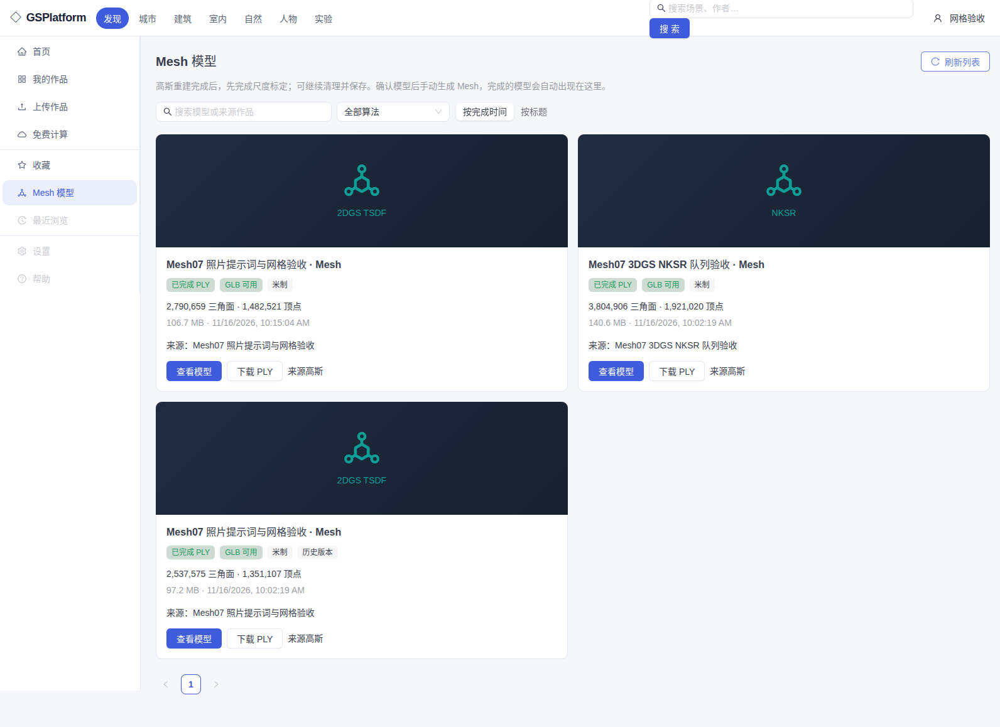
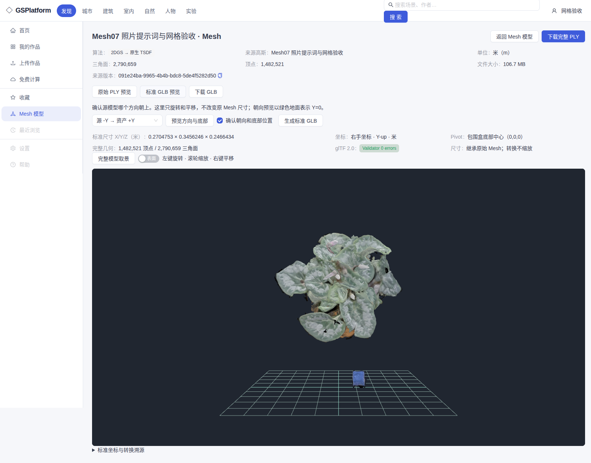
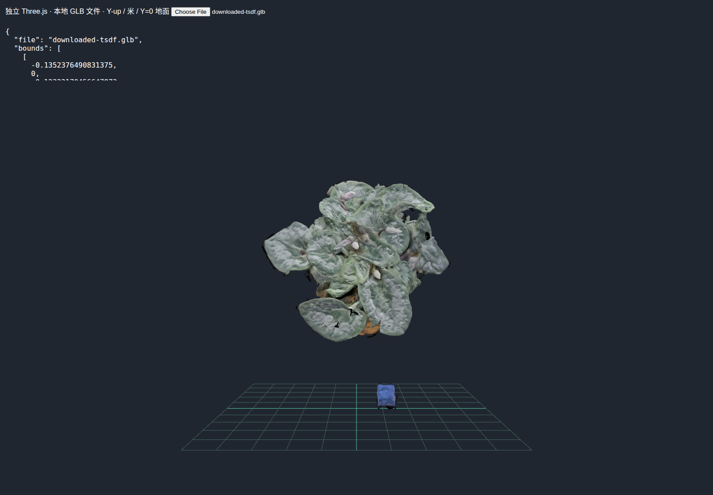
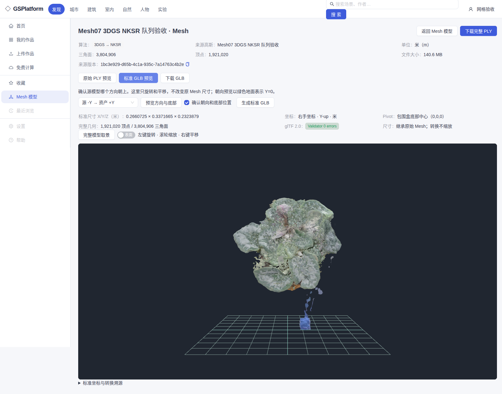
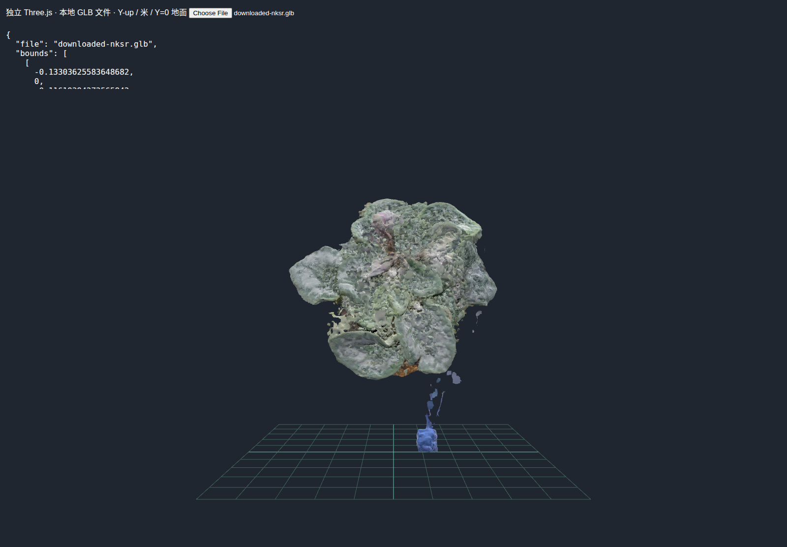
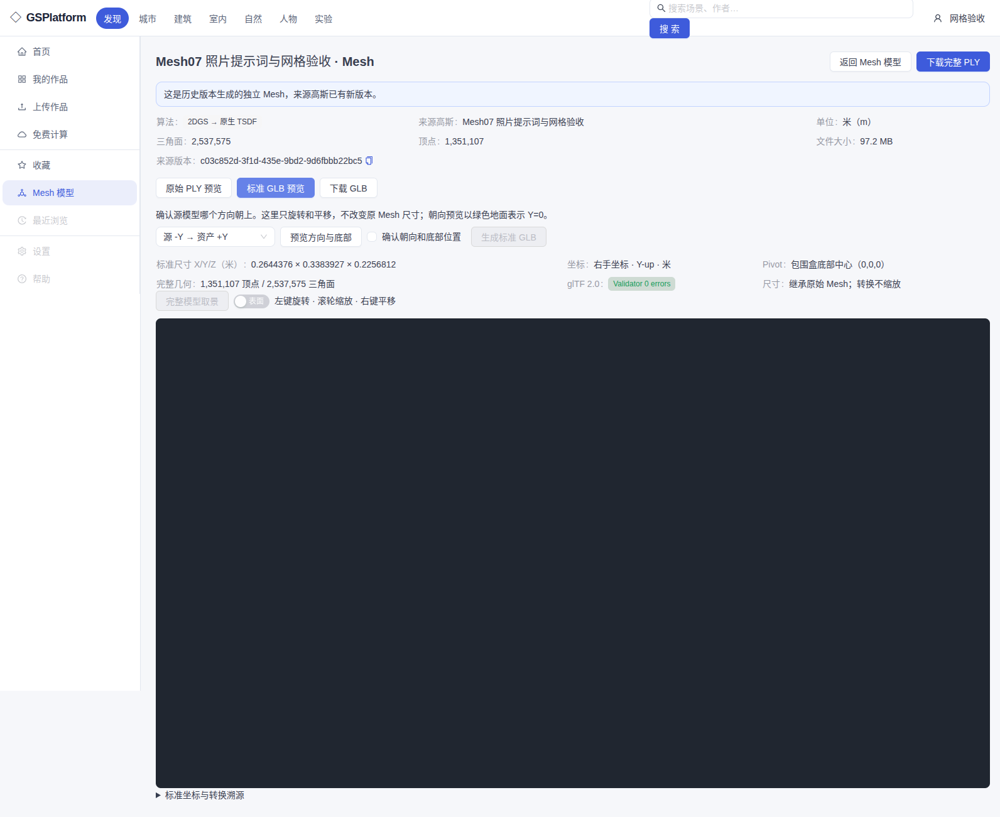

# GS-ASSET-01 标准 Mesh 资产验收

2026-11-16，项目 `/fj/GSPlatform`。执行前 `git fetch origin main`，实际 main 与参考基线均为 `7aeb0bea2742159af69a6b3bafafd8eb182f2e10`，开始时工作区干净。功能提交：`cc8c82f1986bd032c9ea9e9147b4850c92abc11d`；本轮全套测试的代码 HEAD：`991cbe9659d76ae5f23aaf384d880055153c4392`。后续证据提交仅补充测试导入整理、任务注册位置与配置排版和本报告；最终提交号见本报告所在 Git 提交。

已在原 `http://localhost:5174` 上部署 API、CPU worker 和前端，沿用 API `127.0.0.1:18001`、原数据库、原账号和 `/home/test/.local/state/gsplatform-vr00-20261011` 的存储、队列、场景资源。迁移为新增关联表，没有替换环境或另建 Mesh 模型库。运行服务的功能版本为 `cc8c82f`。

## 使用路径与范围

**收藏下面的 Mesh 模型 → 模型详情 → 原始 PLY 预览 → 选择源模型朝上轴 → 预览方向与底部 → 确认朝向和底部位置 → 生成标准 GLB → 标准 GLB 预览 / 下载 GLB。**

页面每 2 秒读取真实 QUEUED / RUNNING / READY / FAILED 状态；失败和失去执行租约的任务可重试。同一输入、方向和转换版本重复点击复用已完成结果。下载完整 PLY 入口保留。

只读取已经生成的完整 Mesh PLY，不重新训练、分割、提取网格或简化面片。GLB 转换全部使用 CPU，复用现有串行 CPU 队列，并限制子进程 BLAS/OMP 为 4 线程。GPU1 未使用；浏览器和既有部署 CUDA 自检仅使用 GPU0。没有实现 ASSET-02 的 Token、外部 Manifest、自动搭建或实例管理。



## 坐标与物理尺寸

输出为 glTF 2.0 二进制 GLB、右手坐标、Y-up、米、`BOTTOM_CENTER`。唯一标准变换定义在 `workers/meshing/asset_coordinates.py`，规则版本 `RH_YUP_BOTTOM_CENTER_V1`。矩阵按行保存，使用列向量：`p_asset = M_asset_from_source × p_source`。

核查链路：COLMAP 相机外参及训练世界坐标没有可靠重力标记；Gaussian 的发布文件保留来源坐标，历史查看器的 Z180 是显示变换。`confirmed_geometry.py` 为复用训练相机撤销一次已保存倍率，NKSR / 原生 TSDF 在该来源坐标下提取；`extract.py::save_mesh` 写 PLY 时应用一次历史标定倍率。Mesh PLY 已包含尺寸，ASSET-01 不读取或再次应用该倍率，也不读取 Gaussian WorldScale。现有 `camera.up=(0,-1,0)` 仅是查看器设置，不能独立证明朝上方向。

因此每件资产明确确认源 ±X / ±Y / ±Z 中的朝上轴，记录确认账号、时间和旋转矩阵。三个真实验收资产使用非对称植株、花盆和偏置蓝色标定块，直接查看 PLY 和朝向预览后确认源 `-Y` 向上。不是对所有历史模型硬编码 -Y；任意倾斜重力恢复不在这个最小轴向确认入口中。

六个允许旋转都满足 `RᵀR=I`、`det(R)=+1`，拒绝反射、缩放和非有限矩阵，因此保持面绕序，不需要翻面。旋转后的包围盒为 `[min,max]`，Pivot=`[(minX+maxX)/2,minY,(minZ+maxZ)/2]`，`M=[R,-Pivot;0,1]`。顶点和法线变换直接烘焙，GLB 根节点保持单位矩阵；标准 GLB 预览和独立页面不再执行任何模型旋转、缩放或偏移。

**尺寸继承自已完成标定发布后生成的米制 Mesh：只旋转和平移，不做二次标定、二次 scaleFactor 或非均匀缩放。**GLB 的 float32 存储有下面实际测得的数值舍入误差，不声称二进制浮点下绝对零误差。原历史标尺的物理真值不由格式转换重新测定。

## 导出、颜色、法线和持久化

转换器为 `trimesh==4.11.4` 的 `export_glb(include_normals=True)`，`process=False`；转换版本 `trimesh-4.11.4-linear-color-v1`。未自行实现 GLB 编码器。代码中的二进制读取器仅用于独立检查导出 accessor、索引和节点。

PLY uint8 RGB 按 sRGB 转换为线性 float32 `COLOR_0`，由 Three.js 官方 GLTFLoader 解码。PBR 白色基色、metallic=0、roughness=1，不生成贴图，不依赖私有扩展。PLY 预览的官方 PLYLoader 也将 sRGB 转线性；截图检查两查看器没有明显变暗或颜色丢失。

保留有效源法线方向并单位化后旋转。实际 NKSR 中存在 1,990 个零法线、历史 TSDF 中 1 个；零向量没有可保留的方向，使用入射面法线补全，仍未定义时使用单位上向量，数量写入元数据。当前 TSDF 的零法线为 0。所有顶点、面片、索引顺序均保持，不删除孤立几何。

数据库迁移 `e6a701000005_mesh_asset_variants.py` 新增现有 MeshModel 的关联表 `mesh_asset_variants`，已在正式库和隔离测试库执行。保存原始 SHA、派生 SHA/大小、格式、输入配方唯一键、导出器/坐标版本、方向证据、状态、执行代数、租约、时间；`result` JSONB 保存源/标准包围盒、米制尺寸、Pivot、完整矩阵、数值误差和官方 Validator 报告。MeshModel UUID、source_version_id、units、原始 SHA 和 PLY 文件不变。

任务在独立代数目录生成 `mesh.tmp.glb`，检查数值、拓扑、颜色、法线、源 SHA 和官方 Validator，成功后原子发布 `mesh.glb`。代数及来源检查阻止过期任务发布，成功目录不覆盖；失败不改变 PLY。相同来源 SHA、方向、坐标版本和导出器版本的配方唯一，跨模型不混用文件。

API 复用现有登录和所有权检查，POST 复用 CSRF；他人资产返回 404，未登录返回 401。没有外部鉴权：

- `GET /api/v1/mesh-models/{id}/file`：原 PLY 语义不变。
- `GET /api/v1/mesh-models/{id}/glb`：资格、方向选项和派生状态。
- `POST /api/v1/mesh-models/{id}/glb`：确认来源 SHA 和朝向后提交 CPU 转换。
- `GET /api/v1/mesh-models/{id}/files/glb?variantId=…`：当前登录所有者下载，`private, no-store`。

## 真实资产数值与文件

本轮使用已有真实照片生成、已走过标定发布路径的 NKSR、TSDF 及历史 TSDF，不以人工方块替代真实模型。这些是既有功能验收账号的 49 照片 / 1,200 迭代作品；历史标定输入示例为模型距离 0.25、实际 20 mm、倍率 0.08，只验证原流程的尺寸传递，不代表照片方块具有独立测得的物理真值。本轮完整转换每个现成 Mesh 的全部顶点和面片，没有用少量照片重新试跑或冒充全量最终重建。原账号的 247 张有效照片 / 30,000 次全量历史产物处理见后面的单位清单。

记录完整来源、所有 SHA、包围盒、矩阵、GLB 文件绝对路径和 Validator 实际输出：[最终文件核查](gs-asset01-evidence/final-verification.json)。大文件不提交 Git，保存在原私有存储，亦已实际通过浏览器下载。

| 模型 | MeshModel ID | 顶点数（PLY=GLB） | 面数（PLY=GLB） | GLB 字节 | GLB 尺寸 XYZ（米） |
| --- | --- | ---: | ---: | ---: | --- |
| 2DGS → TSDF | `50c7d4f7-c7fe-49c9-a14b-a89e05288320` | 1,482,521 | 2,790,659 | 86,860,204 | 0.270475298166 × 0.345624566078 × 0.246643409133 |
| 3DGS → NKSR | `a6de84a4-416f-4007-9734-5bf2bfb32408` | 1,921,020 | 3,804,906 | 114,817,120 | 0.266072511673 × 0.337166458368 × 0.232387885451 |
| 历史 2DGS → TSDF | `71f3c24d-e296-403d-828d-2a2936f8766e` | 1,351,107 | 2,537,575 | 79,092,292 | 0.264437586069 × 0.338392734528 × 0.225681230426 |

### 2DGS → TSDF

原 PLY：`/home/test/.local/state/gsplatform-vr00-20261011/storage/meshes/0658c9e6-d07a-4b71-bd3d-11446c3d529b/fcd7bb1b-117c-4b37-ab95-7a096d29bc8f/mesh.ply`。

GLB：`/home/test/.local/state/gsplatform-vr00-20261011/storage/mesh-assets/50c7d4f7-c7fe-49c9-a14b-a89e05288320/9083f48a-98eb-4bb1-9001-7965bc5c1afd/generation-1/mesh.glb`。

原 SHA256：`5bfa15640883af0c2e2be7d0b7341974ed3cd00893a0d0122c4671ca54c618b7`。

GLB SHA256：`8ca6746f6abfb963107639cc3e884e6fb09983cd3d7420379a9857383c869176`。

M_asset_from_source：

```json
[[-1.0, 0.0, 0.0, -0.02626644904548598], [0.0, -1.0, 0.0, 0.2595083773190752], [0.0, 0.0, 1.0, -0.3404623421221857], [0.0, 0.0, 0.0, 1.0]]
```

源包围盒：

```json
[[-0.1615040962756703, -0.08611618778074341, 0.217140639200278], [0.10897119818469835, 0.2595083773190752, 0.4637840450440933]]
```

标准包围盒：

```json
[[-0.1352376490831375, 0.0, -0.12332170456647873], [0.1352376490831375, 0.34562456607818604, 0.12332170456647873]]
```

旋转后源坐标中的 Pivot：

```json
[0.02626644904548598, -0.2595083773190752, 0.3404623421221857]
```

对应顶点最大分量误差 `1.49010790929e-08 m`；对全部顶点与其相邻索引点测得的最大距离误差 `2.91099223558e-08 m`。

### 3DGS → NKSR

原 PLY：`/home/test/.local/state/gsplatform-vr00-20261011/storage/meshes/cdba52f2-309c-42e2-890e-4a78a901c84b/a8614268-9e59-4d67-bf6c-a0baa71d9bd7/mesh.ply`。

GLB：`/home/test/.local/state/gsplatform-vr00-20261011/storage/mesh-assets/a6de84a4-416f-4007-9734-5bf2bfb32408/3fc29449-2492-4f68-90a1-62cd046c91f4/generation-1/mesh.glb`。

原 SHA256：`25411b02662d6aca1961cb85c08db25d7a16ab6adef25d2e7566b0e021fcd3c9`。

GLB SHA256：`795044ea7823ebfc7f5f93215ccbd7bb548111c28bab3c52e10552779f3d8695`。

M_asset_from_source：

```json
[[-1.0, 0.0, 0.0, -0.02611557006835937], [0.0, -1.0, 0.0, 0.25304183959960935], [0.0, 0.0, 1.0, -0.33150869369506836], [0.0, 0.0, 0.0, 1.0]]
```

源包围盒：

```json
[[-0.1591518211364746, -0.08412463188171387, 0.21531475067138672], [0.10692068099975587, 0.25304183959960935, 0.44770263671875]]
```

标准包围盒：

```json
[[-0.13303625583648682, 0.0, -0.11619394272565842], [0.13303625583648682, 0.3371664583683014, 0.11619394272565842]]
```

旋转后源坐标中的 Pivot：

```json
[0.02611557006835937, -0.25304183959960935, 0.33150869369506836]
```

对应顶点最大分量误差 `1.49011611938e-08 m`；对全部顶点与其相邻索引点测得的最大距离误差 `2.92062759394e-08 m`。

### 历史 2DGS → TSDF

原 PLY：`/home/test/.local/state/gsplatform-vr00-20261011/storage/meshes/0658c9e6-d07a-4b71-bd3d-11446c3d529b/e9a81c48-cf09-44bd-bf2d-a7fab25c9485/mesh.ply`。

GLB：`/home/test/.local/state/gsplatform-vr00-20261011/storage/mesh-assets/71f3c24d-e296-403d-828d-2a2936f8766e/8d38fd4d-5c01-4066-8adb-651bb4e0a10a/generation-1/mesh.glb`。

原 SHA256：`ab81c14b8718470832943134dd6fb148f72411062c6f5453026ace01054a43a0`。

GLB SHA256：`04c75fea9670a320ab983eb5e78b5d88b9adc8c46599ff0f250ac8909e57e46c`。

M_asset_from_source：

```json
[[-1.0, 0.0, 0.0, -0.0258058609848019], [0.0, -1.0, 0.0, 0.2542892144232726], [0.0, 0.0, 1.0, -0.33023263922849855], [0.0, 0.0, 0.0, 1.0]]
```

源包围盒：

```json
[[-0.1580246543451352, -0.08410350922250481, 0.21739202593637022], [0.10641293237553141, 0.2542892144232726, 0.44307325252062685]]
```

标准包围盒：

```json
[[-0.13221879303455353, 0.0, -0.11284061521291733], [0.13221879303455353, 0.3383927345275879, 0.11284061521291733]]
```

旋转后源坐标中的 Pivot：

```json
[0.0258058609848019, -0.2542892144232726, 0.33023263922849855]
```

对应顶点最大分量误差 `1.49011553097e-08 m`；对全部顶点与其相邻索引点测得的最大距离误差 `2.89973323733e-08 m`。

三个验收旋转只改变各轴符号，所以源 / 标准各轴尺寸可直接对比：

| MeshModel（缩写） | PLY 尺寸 XYZ（米） | GLB 尺寸 XYZ（米） |
| --- | --- | --- |
| `50c7d4f7` | 0.270475294460 × 0.345624565100 × 0.246643405844 | 0.270475298166 × 0.345624566078 × 0.246643409133 |
| `71f3c24d` | 0.264437586721 × 0.338392723646 × 0.225681226584 | 0.264437586069 × 0.338392734528 × 0.225681230426 |
| `a6de84a4` | 0.266072502136 × 0.337166471481 × 0.232387886047 | 0.266072511673 × 0.337166458368 × 0.232387885451 |

旋转严格正交，理论上任意两点距离不变；除了逐顶点和全体相邻索引点比较，还由逐顶点误差给出任意两点距离误差上界 `2√3 × max_component_error < 5.17×10⁻⁸ m`。拓扑索引逐项相等；所有 `COLOR_0` 与源 sRGB 转换结果逐项相等；源法线到 GLB 最大分量误差小于 `3×10⁻⁸`。

## Validator 与跨查看器验收

官方 `gltf-validator@2.0.0-dev.3.10` 的 `validateBytes` 实际检查三个完整 GLB：每份 **0 errors、0 warnings、0 infos、4 hints**。4 个 hint 均为导出器未设置可选 `bufferView.target` 的 `BUFFER_VIEW_TARGET_MISSING`，完整报告保存在各资产元数据中，未屏蔽任何问题。glTF 2.0、1 个材质、1 个 primitive、POSITION/NORMAL/COLOR_0、完整三角索引、无纹理/骨骼/外部资源/私有必需扩展。

使用原入口 Chrome 145、已有普通验收账号真实登录。依次加载完整 PLY、方向确认预览、提交生成，等正式 CPU worker 完成，切换 GLB、实际下载。TSDF 约 15 秒、NKSR 约 22 秒（[正式 CPU 队列记录](gs-asset01-evidence/cpu-queue-execution.txt)，本机这次记录，不是耗时承诺）。再次点击生成返回同一 `9083f48a-98eb-4bb1-9001-7965bc5c1afd` READY，数据库执行代数仍为 1；见 [重复提交](gs-asset01-evidence/idempotent-live.json)。

独立页面 `apps/web/tests/manual/standard-mesh.html` 用本地文件输入加载刚下载的 GLB，不请求 GSPlatform API，地址 `http://localhost:5174/tests/manual/standard-mesh.html`。官方 GLTFLoader 直接加载，场景加入 Y=0 地面，根节点单位矩阵，不附加模型变换。

| 资产 | GSPlatform 包围盒 / 尺寸 | 独立 Three.js 包围盒 / 尺寸 | 底部 / 根矩阵 |
| --- | --- | --- | --- |
| TSDF | [实际数据](gs-asset01-evidence/tsdf-platform-view.json) | [实际数据](gs-asset01-evidence/tsdf-independent-view.json)，逐项完全一致 | minY=0 / I₄ |
| NKSR | [实际数据](gs-asset01-evidence/nksr-platform-view.json) | [实际数据](gs-asset01-evidence/nksr-independent-view.json)，逐项完全一致 | minY=0 / I₄ |

由本模型直接查看截图：叶片、花盆和偏置蓝块在两个查看器中方向、比例和颜色一致；蓝块是全包围盒的最低点，所以按规则落地，植株底部不必落地。这是包围盒底部中心，未推断接触点。PLY 原来已经存在的碎片、孔洞或重建缺陷也一并保留。









[原始 TSDF PLY](gs-asset01-evidence/tsdf-ply.png)、[方向确认](gs-asset01-evidence/tsdf-orientation.png)、[原始 NKSR PLY](gs-asset01-evidence/nksr-ply.png)、[NKSR 方向确认](gs-asset01-evidence/nksr-orientation.png)。[浏览器记录](gs-asset01-evidence/browser-results.json)中 pageerror 为 0；历史 PLY 切换 / 下载出现 2 条 `net::ERR_ABORTED`，实际完整 PLY 下载成功且 SHA 匹配，不把这两条隐藏为零失败请求。

## 历史资产与环境兼容

5 份原始 Mesh 的 ID、来源 SceneVersion、units、顶点/面数、目录文件 SHA 全部与执行前一致。历史 TSDF `71f3…` 通过现有 CPU 队列批量入口完成，当前来源高斯已更新，详情仍显示历史版本，原 PLY 实际下载 SHA 仍为 `ab81c14b…a43a0`。未重跑它的 Mesh 提取。



原 building ID=`e2f54542-40a1-494f-b260-ad8fd28156e6`，版本=`01c63c7c-8eb5-498e-bcc0-77215e92ca12`，slug=`u-06924576399e`，资源索引 SHA=`df735f57c853a77c5b5a758a6c19c5b7e76654581e9f8aba13521f7088fa75ab` 全部不变。未重置原账号或替换数据源。

原账号两份全量历史 Mesh 的来源记录明确仍为 `scene`；不能证明已经标定为米，本轮不篡改单位，也不凭倍率转成“米制 GLB”：

| MeshModel ID | 算法 / 原三角面 | 状态 / 处理 |
| --- | --- | --- |
| `88fbd571-69de-5d89-89f9-fec55b4d66b8` | gsplat → NKSR / 573,486 | BLOCKED：缺少米制证据，PLY 与元数据保持原样 |
| `f5b98fef-cc93-56e8-b5b8-7defe0d5ecb4` | 2DGS → TSDF / 2,675,832 | BLOCKED：缺少米制证据，PLY 与元数据保持原样 |

[迁移清单](gs-asset01-evidence/unknown-units-plan.json)。没有要求用户为格式转换重新标定。以后若来源证据能证明已是米制，才可单独修正元数据，不修改几何。本轮没有这种可证明的数据修正。

历史批量入口：`scripts/convert_mesh_assets.py --owner-id UUID` 默认只列计划；确认每件方向后用 `--model-id UUID --apply --up-axis=-Y --confirm-orientation` 提交；方向不同的资产分别处理。须使用当前托管环境配置，不另启后端或 GPU 队列。

## 测试结果

以下测试始终使用隔离测试数据库，未用测试配置覆盖用户入口。

| 检查 | 实际结果 |
| --- | --- |
| API pytest 全套 | 680 项均已覆盖并通过：CPU 首轮 675 通过，5 项因隐藏全部 CUDA 而失败 / setup error；仅开放 GPU0 后定向补跑 6 项通过（5 项 GPU 检查 + 1 项重复静态检查），未修改或跳过断言 |
| Mesh API / CPU worker 定向 | 33 项通过，包含现有 Mesh 模型 / 提取流程和新转换器 |
| 独立转换器数值测试 | 上述定向集中的 11 项通过，六个方向、拓扑、颜色、尺度保持、无效矩阵和源 SHA |
| Vitest | 50 个文件、524 项通过，包含新的 GLB 确认和预览检查 |
| TypeScript | `pnpm --filter @gsplatform/web typecheck` 通过 |
| Oxlint | `pnpm --filter @gsplatform/web lint` 通过 |
| 生产构建 | `pnpm --filter @gsplatform/web build` 通过，Vite 构建 3.45 秒；保留大于 500 kB 的 chunk 提示，没有通过减少模型面片解决 |
| Python Ruff | 本轮所有改动的 Python 文件通过 |
| 真实浏览器 E2E | Chrome 145 + Playwright，原 5174、真实普通登录、PLY/GLB 切换、方向确认、正式 CPU 执行、下载、独立页面加载、历史 Mesh、重复提交均完成；pageerror=0 |
| 官方 glTF Validator | 三个真实完整 GLB 各 0 errors / 0 warnings，4 条 hint 明示 |

[结构化测试结果](gs-asset01-evidence/test-summary.json)、[API 首轮记录](gs-asset01-evidence/api-full-cpu-summary.txt)、[GPU0 补跑](gs-asset01-evidence/api-gpu0-runtime-recheck.txt)、[Mesh / worker](gs-asset01-evidence/api-worker-tests.txt)、[Vitest](gs-asset01-evidence/web-tests.txt)、[类型检查](gs-asset01-evidence/web-typecheck.txt)、[Oxlint](gs-asset01-evidence/web-lint.txt)、[构建](gs-asset01-evidence/web-build.txt)、[Ruff](gs-asset01-evidence/ruff.txt)、[CPU 路由 / 任务注册](gs-asset01-evidence/cpu-routing.json)。API 的 Starlette 弃用警告仍保留。

GPU 自检是既有部署测试中的小规模 gsplat 光栅化和 JIT 编译，不重新训练任何资产，未启动网格生成任务；编译使这次补跑耗时约 15 分钟。

新增覆盖：拒绝缩放 / 反射 / 不正确源 SHA / 未确认方向 / 未知单位；登录、CSRF、他人不可读取；真实 Trimesh + 官方 Validator + CPU 子进程生成；重复提交复用；失败重试与代数隔离；过期执行不能覆盖成功结果；PLY 下载和历史结果兼容；前端先确认再生成、直接 GLB 加载且不添加方向变换。

## 验收标志与未完成项

| 标志 | 状态 | 证据 |
| --- | --- | --- |
| PLY_IMMUTABLE | PASS | 五份源 SHA、ID、版本全部不变，历史 PLY 下载实际匹配 |
| GLB_EXPORT_READY | PASS | 三份 READY，完整百万级几何，真实下载两份 GLB |
| CANONICAL_COORDINATES | PASS | 每件确认朝上轴，正交正行列式矩阵，Y-up 顶点烘焙，根节点 I₄ |
| METRIC_SIZE_PRESERVED | PASS | 继承源米制数据、scaleApplied=1，逐顶点与距离误差记录 |
| PIVOT_BOTTOM_CENTER | PASS | 三份 minY=0，X/Z 包围盒中心=0，独立查看器地面一致 |
| VERTEX_COLOR_PRESERVED | PASS | 完整 COLOR_0 数值比较与两查看器真实截图 |
| GLTF_VALIDATOR_PASS | PASS | 三份官方验证 0 errors / 0 warnings；4 hints 如实保留 |
| MESH_LIBRARY_GLB_READY | PASS | 原入口列表、状态、方向确认、PLY/GLB 切换、两格式下载 |
| CROSS_VIEWER_CONSISTENCY | PASS | TSDF / NKSR 的全几何数量、包围盒、尺寸和根矩阵逐项一致 |
| LEGACY_MESH_COMPATIBILITY | PASS | 历史米制 Mesh 已转换；原 scene 单位完整保留并列清单 |
| ASSET_01_READY | PASS | 已有米制 Mesh 的标准资产流程可用；未知单位不冒充米制 |

保留限制：上述两份 `scene` 旧资产暂不生成标准米制 GLB；旧标定示例未取得独立物理真值，格式转换不替代真实标定准确性；最小方向确认只支持六个源轴，不实现任意重力恢复；百万级完整几何的浏览器与 CPU 内存消耗随规模增加。没有静默减面或新增认证流程。ASSET-02 未实施，本任务在此停止。

## 信息来源

实现与验收结论来自仓库实际代码、原托管数据库 / 文件、真实 CPU worker、官方 Validator 和直接查看浏览器截图。博查请求返回 HTTP 403，搜索不可用；没有用未获取的搜索结果支撑结论。库接口使用 Context7 获取 Trimesh / Three.js 文档，并读取官方规范和 Validator README：

- [glTF 2.0 官方规范](https://registry.khronos.org/glTF/specs/2.0/glTF-2.0.html)
- [Trimesh glTF 导出文档](https://trimesh.org/trimesh.exchange.gltf.html)
- [Khronos glTF Validator Node API](https://github.com/KhronosGroup/glTF-Validator/blob/main/node/README.md)
- [Three.js GLTFLoader](https://threejs.org/docs/#examples/en/loaders/GLTFLoader)
- [既有 Mesh 来源与历史单位记录](GS_MESH_10_ACCEPTANCE.md)、[既有标定输入示例和实际流程](GS_MESH_07_ACCEPTANCE.md)。
