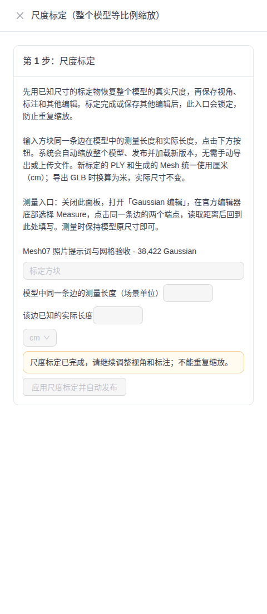
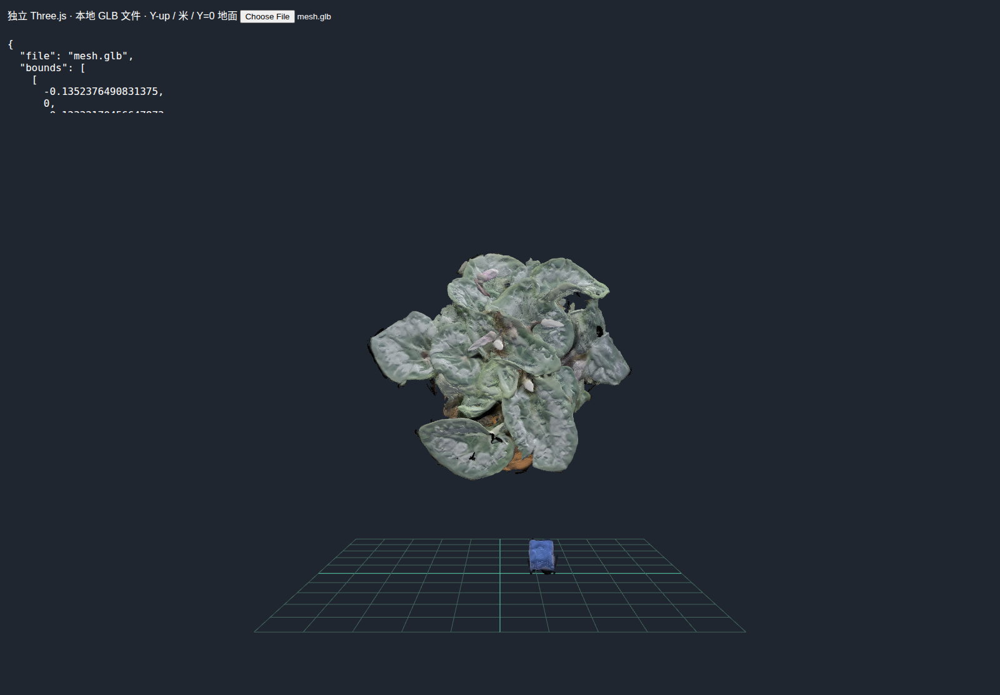
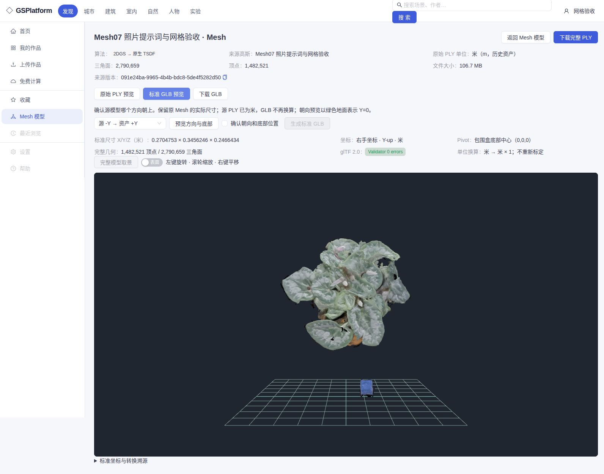

# GS-ASSET-01 厘米单位修正

2026-11-16，功能提交 `2d71bd3bb44a59afb817a1d3d30b027359210367`。用户明确：照片重建后手动测量标定物、填写真实长度、应用整体尺度，再生成 Mesh；新标定的 Gaussian PLY 和 Mesh 坐标采用 **厘米（cm）**。本次以此修正后续生成流程。

## 最终规则

| 环节 | 坐标单位与处理 |
| --- | --- |
| 原始重建 Gaussian | 任意重建单位，尚未标定 |
| 手动测量并应用标定 | `实际长度换算为 cm / 原测量距离`，只应用一次；输入框默认 cm，也接受 mm、m |
| 标定发布后的 Gaussian | `geometryUnits=cm`，每个场景单位对应 `0.01 m` |
| NKSR / TSDF 生成的 Mesh PLY | 继承已标定尺度，记录 `units=cm` |
| GLB | 标准单位米；读取明确的源单位，cm 只乘 `0.01`，m 乘 `1`；不再次应用标定倍率 |
| 原有文件 | 原始 PLY、MeshModel ID、来源版本、SHA 和已有 GLB 全部保留 |

例：原测量距离 `0.25`，实际边长 `20 cm`，应用倍率 `80`。Gaussian / Mesh PLY 中该边长为 `20`，GLB 中为 `0.2`。两者物理尺寸相同。`200 mm`、`20 cm`、`0.2 m` 三种输入生成相同厘米坐标。

之前代码在标定时直接换算为米，因此既有三份功能验收 Mesh 确实是 m。它们不是只贴错了标签的 cm 文件，不能将原坐标再乘 `0.01`。本次没有重标定、重标单位或改写这些历史资产。两份原 `scene` 单位的全量历史资产也保持未标定状态；新规则不为它们虚构标定记录。

## 代码与数据

- 标定服务按 cm 计算倍率，将 `geometryUnits=cm` 写入发布证据；处理设置保存 `meters_per_scene_unit=0.01`。旧队列中没有该字段的标定仍按原 m 语义完成，不改变已提交任务。
- Mesh 服务将单位与标定倍率一起绑定到当前 Gaussian 来源版本，worker 将 `--units cm` 传给实际网格写出程序；写出厘米顶点、厘米单位和正确换算后的 `boundsMeters`。
- 新增迁移 `e6a701000006_mesh_centimeters.py`，仅扩展原 `mesh_models.units` 约束为 `cm | m | scene`；没有创建第二套资产表或修改已有行的单位。正式库及隔离测试库均已执行。降级时如有 cm 记录则拒绝丢失单位信息。
- 派生配方包含源单位，转换器为 `trimesh-4.11.4-linear-color-v2-units`，坐标规则为 `RH_YUP_BOTTOM_CENTER_UNITS_V2`。输出元数据明确记录 `sourceUnits`、`unitConversionScale`、`calibrationScaleApplied=1`。
- `sourceToAssetMatrix` 烘焙单位换算、正交旋转和底部中心平移。源 cm 时左上块为 `0.01 × R`；这是单位换算，不是再次求取真实尺度。`rotation` 本身仍满足正交、det=+1。源包围盒、源 Pivot 使用原单位，标准包围盒和 `dimensionsMeters` 使用米。
- 前端显示原 PLY 单位和 GLB 换算规则；PLY 文件名区分 centimeters / meters，下载 API 沿用原鉴权。标准 GLB 预览不添加模型缩放。

部署沿用原 `5174 → API 18001`、同一数据库、存储、账号及队列。重启前检查托管 worker active / reserved 均为空，未中断训练或网格任务；未使用 GPU1。后续仅有前端单位说明、默认 cm 与类型声明补充。

## 数值与真实文件验证

实际调用现有 Open3D `save_mesh`，不是重写一套测试输出器：输入边长 `0.25`、倍率 `80`，重读写出的 PLY 得到边长 `20`，`units=cm`，米制包围盒边长 `0.2`。[实际写出结果](gs-asset01-cm-evidence/extractor-result.json)。

此外复用已有完整 TSDF / NKSR 的全部几何，在私有测试目录中将它们从 m 表示转换为 cm 表示，再调用生产 GLB 导出器测试 `cm → m`。这些是**现有真实网格的单位表示副本**，没有将它们冒充新拍摄、新标定或重新训练的资产，也没有将副本登记到用户模型库。两份原始文件 SHA 保持不变。

| 真实网格来源 | 保留顶点 / 三角面 | GLB 尺寸 XYZ（m） | 与原 m 表示 GLB 的最大顶点差 |
| --- | --- | --- | --- |
| 2DGS → TSDF，`50c7d4f7…` | 1,482,521 / 2,790,659 | 0.270475298166275 × 0.34562456607818604 × 0.24664340913295746 | 0 m |
| 3DGS → NKSR，`a6de84a4…` | 1,921,020 / 3,804,906 | 0.26607251167297363 × 0.3371664583683014 × 0.23238788545131683 | 0 m |

完整索引与颜色逐项一致；每份 GLB 官方 Validator 为 **0 errors、0 warnings**，保留 4 条可选 bufferView.target hint。[完整数值、矩阵、原 / 派生 SHA 及文件路径](gs-asset01-cm-evidence/real-units-verification.json)。

新 CM 转换后的 TSDF GLB 在独立 Three.js 页面中实际打开：1,482,521 顶点、2,790,659 面，包围盒和尺寸与原米制表示完全一致，根节点单位矩阵、Y=0 地面，没有额外模型旋转或缩放。[浏览器测量](gs-asset01-cm-evidence/independent-centimeter-conversion.json)。

## 测试

- 标定、Mesh、派生 GLB、历史兼容及确认后几何处理相关 pytest：**52 项通过**。包含 mm / cm / m 三种输入均输出 cm、真实 CPU 转换和鉴权下载、cm 与历史 m 的两条分支。
- 单独转换器数值测试 **12 项通过**，包含官方 Validator、cm → m 距离、原始 PLY 不变、无隐藏节点变换；上述 52 项已包含这 12 项，不重复计数。
- 官方 Gaussian 转换器实际执行测试 **2 项通过**，分别检查历史 m 倍率与新 cm 倍率，完整保留 Gaussian 属性。
- 前端完整 Vitest **50 个文件、525 项通过**；TypeScript、Oxlint、生产构建和改动 Python Ruff 均通过。生产构建保留大 chunk 提示。
- 原入口 Chrome 145 正常账号登录、标定单位说明、旧米制 Mesh 预览，以及独立页面加载新 cm 转换 GLB 完成，pageerror=0；切换时两条旧 PLY 请求为 ERR_ABORTED，GLB 实际加载完成。[浏览器记录](gs-asset01-cm-evidence/browser-result.json)。本轮浏览器没有对已经锁定的旧作品再次提交标定；cm 新提交由隔离 API / worker 测试与实际转换器执行验证。
- 更广 API 回归共 680 个非 GPU 检查得到覆盖：679 项通过，1 项旧导出保留清理检查因累计超过 100 条历史过期测试记录而未选中本次记录，在全新隔离库中保持原断言单独复测通过。另 5 个既有 CUDA 部署自检不纳入本轮 CPU 单位修正回归；首轮关闭 CUDA 的尝试中它们因无可见显卡失败，上轮 GPU0 检查已通过，本轮未为单位变更再次编译。没有更改清理逻辑或 GPU 运行环境。[CPU 汇总](gs-asset01-cm-evidence/api-cpu-summary.txt)、[全新隔离库复测](gs-asset01-cm-evidence/retention-fresh-recheck.txt)。

记录：[相关 pytest](gs-asset01-cm-evidence/pytest.txt)、[转换器](gs-asset01-cm-evidence/converter-tests.txt)、[Gaussian 转换器](gs-asset01-cm-evidence/gaussian-scale-tests.txt)、[Vitest](gs-asset01-cm-evidence/vitest.txt)、[类型检查](gs-asset01-cm-evidence/typecheck.txt)、[Oxlint](gs-asset01-cm-evidence/oxlint.txt)、[生产构建](gs-asset01-cm-evidence/build.txt)、[Ruff](gs-asset01-cm-evidence/ruff.txt)。

正式环境再次核对：原始 5 份 Mesh 的 ID、来源版本、单位、顶点 / 面数及 SHA 完全不变，原 3 份 GLB 保留；building 当前版本及资源索引 SHA 不变。[原资产核查](gs-asset01-cm-evidence/legacy-unchanged.txt)。

本轮修正单位业务约定，不重新训练或生成用户的旧 Mesh，不重复标定，不实施 ASSET-02。结论来自本地代码、数据库、实际文件和浏览器；博查搜索返回 HTTP 403，未使用搜索结果替代实际核查。[glTF 2.0 单位规范](https://registry.khronos.org/glTF/specs/2.0/glTF-2.0.html)与上轮已读取的官方文档仍适用。
