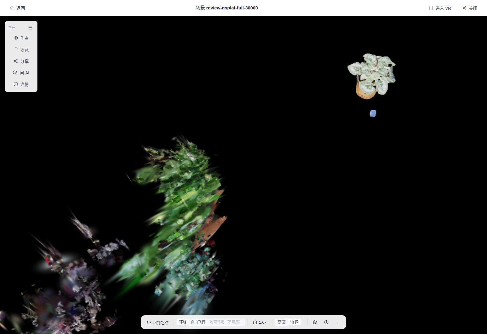
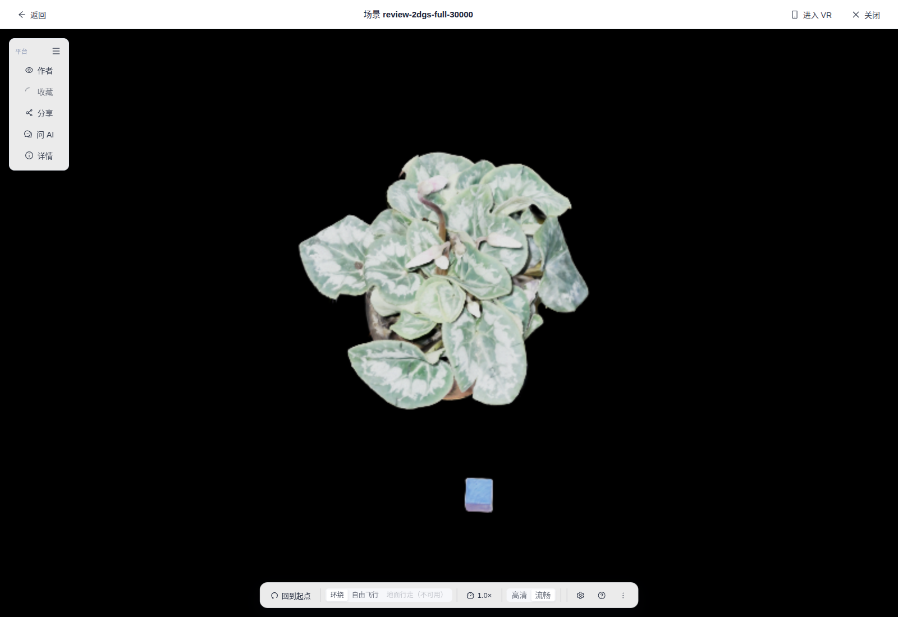
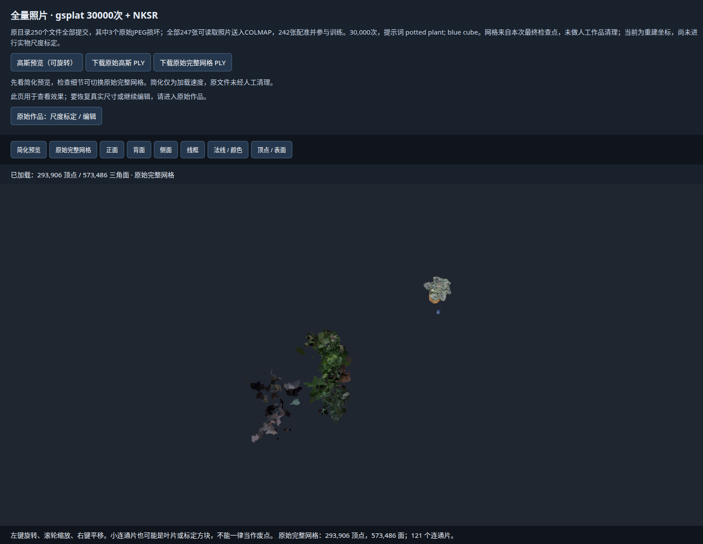
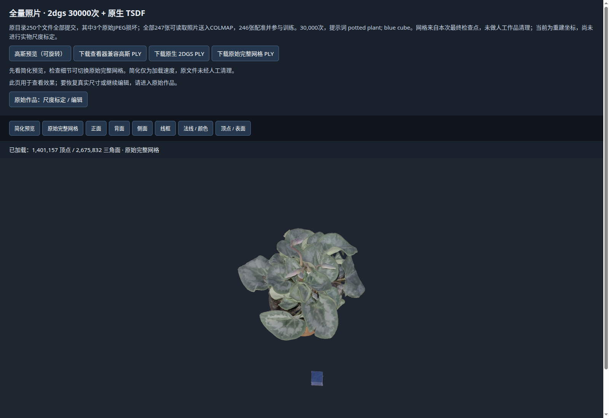
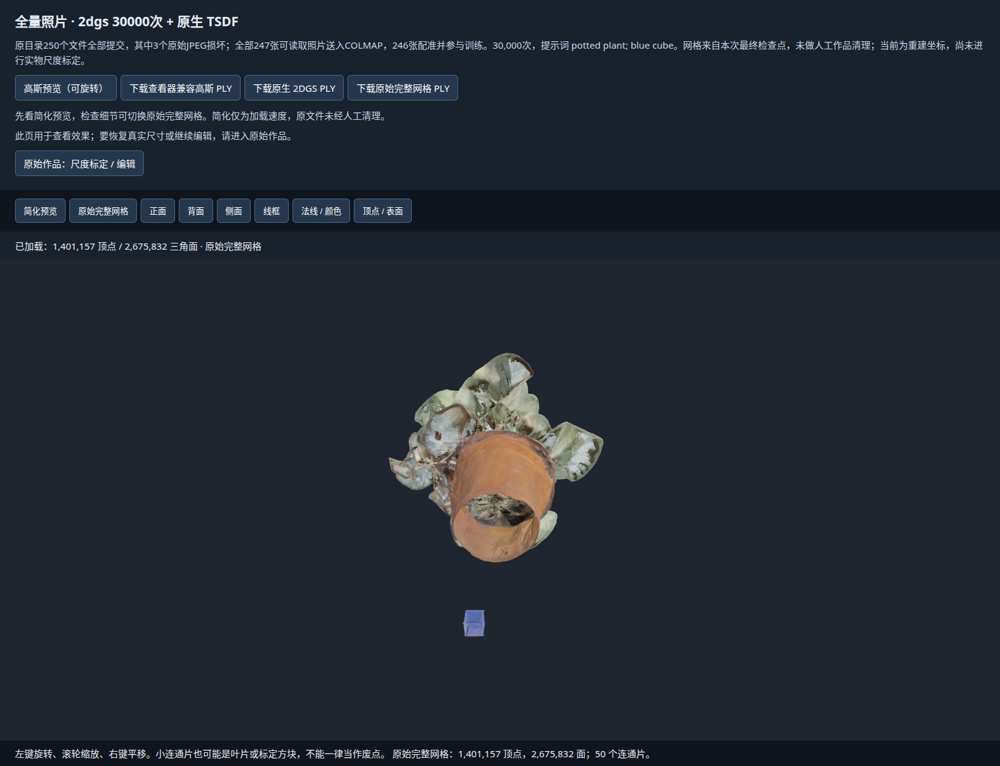

# GS-FULL-09：全量照片、30,000 次重建与最终网格

2026-11-15，gsplat 和 2DGS 的全量重建、对应 NKSR / 原生 TSDF 网格均完成，并在原 `http://localhost:5174` 实际加载与下载验收。沿用原 API、账号、数据库、队列和存储。当前运行的功能代码为主分支 `d0fc4d1`。

原目录 `/data/fj/Pheno-MCMC/data/01-FFmepg/XianKeLai1` 的 250 个文件全部实际上传，逐文件 SHA256 与上传暂存文件一致。`0111.jpg`、`0130.jpg`、`0134.jpg` 原文件损坏，现存备份同样损坏；全部 **247 张可解码照片**均送入两条流程的 COLMAP、特征提取、匹配和 SAM3 分割，没有按步长抽样。高精度档位将图片宽度缩放至 1920，训练 `downscale=1`；全量照片不代表不缩放原始分辨率。保留目标提示词为 `potted plant; blue cube`。

| 项目 | gsplat / 3DGS | 2DGS |
| --- | --- | --- |
| 重建任务 | `1dd697e2-5894-4c2f-a082-e2a168eb000c` | `b6630a28-65bd-42b4-b9d8-ca7070268ac3` |
| 实际处理照片 / 有效掩膜 | 247 / 247 | 247 / 247 |
| 成功配准并参与训练 | 242 | 246 |
| 未配准的可读原图 | `0088, 0090, 0091, 0098, 0177.jpg` | `0177.jpg` |
| 实际完成迭代 | 30,000 | 30,000 |
| 最终检查点步号 | 29,999，从零编号 | 30,000，从一编号 |
| 最终高斯数 | 600,103 | 375,688 |
| 网格方法 | NKSR | 原生 bounded TSDF，分辨率 1024 |
| 原始网格顶点 | 293,906 | 1,401,157 |
| 原始网格三角面 | 573,486 | 2,675,832 |
| 原始网格字节 | 22,444,850 | 106,245,151 |

输入文件与训练检查点分别独立核查：[逐文件对应、配准与排除记录](gs-full09-evidence/full-input-verification.json)、[最终检查点和高斯校验](gs-full09-evidence/full-training-verification.json)。两个任务最终状态均为 `SUCCEEDED`。没有拿此前的 49 张照片或 1,200 次草稿作为本轮结果。

登录原账号后使用以下普通链接。网格页面同时提供完整高斯 PLY、完整网格 PLY 下载；2DGS 另保留原生双尺度 PLY 和供现有查看器显示的薄椭球兼容 PLY。

| 算法 | 高斯预览 | 网格预览与下载 |
| --- | --- | --- |
| gsplat | [查看高斯](http://localhost:5174/scene/review-gsplat-full-30000) | [NKSR 网格及 PLY](http://localhost:5174/api/v1/scenes/review-gsplat-full-30000/assets/versions/7dac4cdfda03e72f/review/index.html) |
| 2DGS | [查看高斯](http://localhost:5174/scene/review-2dgs-full-30000) | [TSDF 网格及 PLY](http://localhost:5174/api/v1/scenes/review-2dgs-full-30000/assets/versions/9edfac9ac523d157/review/index.html) |

这两份是原账号名下的私有效果预览副本。默认高斯相机对准全部拍摄视轴的交会点，以方便检查主体；数据没有裁掉周围残留。原始作品分别为 `r-0407bfd4b545`、`r-c2984c52a635`，两者的首次尺度标定入口仍开放。网格页的「原始作品：尺度标定 / 编辑」直达对应原始作品。

本轮质量网格保留原重建坐标，倍率为 1，**尚未取得真实物理尺度**。不能把坐标单位当作米；要测量真实尺寸，应先在原始作品用已知尺寸方块标定，再由已有自动流程生成米制网格。本轮没有填入虚构的模型距离，也没有改动原作品的标定锁。

本机直接查看浏览器截图后，本数据及当前网格默认配置下，2DGS 的叶片表面比 NKSR 更连续，周围背景碎片也更少。两份高斯全景均仍有周围植株残留和拉丝；NKSR 网格明显保留部分背景碎片，主体也有粗糙表面。2DGS 网格背面可见孔洞和缺面，不能称为完整闭合或无废点模型。没有对原始高斯或下载网格做人工作品清理。

两条流程独立求解相机，配准数量不同；两种网格方法的分辨率与默认组件过滤也不同。因此上述结论是这批素材和现有配置的效果观察，不能作为控制相同位姿、分辨率和后处理后的算法优劣基准。NKSR 使用全部 242 个注册视角的深度与定向法线，按现有资源上限汇总 150,000 个表面观测点；2DGS 将全部 246 个注册视角用于原生 TSDF 融合。小连通片不能直接视作废点，叶片及标定方块本身可能断开。

浏览器验收使用 Chrome 145、既有私有验收账号正常登录，再通过仅针对两份预览副本的临时分享授权读取资源；未重置原账号密码，未声称用未知的原密码登录。验收完成后已撤销这两份临时授权，原账号的所有者访问保留。浏览器实际加载完整 573,486 / 2,675,832 面网格，分别下载两个完整网格及三个高斯 PLY；下载字节 SHA256 与本次最终产物一致。Open3D 独立重读下载网格，确认顶点数、三角面、有限坐标、颜色和包围盒均匹配。[浏览器记录](gs-full09-evidence/full-browser-check.json)中 `pageerror` 和失败请求均为零；[下载独立核查](gs-full09-evidence/full-download-independent-verification.json)保留完整计数和摘要。轻量页面预览约 250,000 面，完整原文件保持不变。

全量运行暴露并修复了以下实际问题，均有先失败后通过的回归检查。相关检查最终共 **48 项通过**；新增检查 Ruff 与 `git diff --check` 通过。

- `6d7a8e7`：COLMAP CPU SIFT 默认使用全部核心，本机真实触发约 88 GiB RSS 后被内核 OOM 杀死。将提取、匹配和 mapper 的线程数按档位限制，高精度默认为 8；保留全量照片继续运行。
- `8a80baf`：CPU/GPU 队列原硬限制短于高精度档位的资源预算。按全部档位最大预算设置阶段任务软硬截止时间。
- `ea90a4f`：映射质量门选择最大模型，但训练和网格固定读 `sparse/0`。本轮 2DGS 的模型 0 只有 3 个视角，最大模型 1 有 246 个。将通过门控的模型规范到 `sparse/0`，原模型另存；确认本轮实际训练 246 张，而非那 3 张。
- `d0fc4d1`：Redis 默认一小时可见性窗口导致仍在运行的长任务重复投递。发送端及全部 worker 统一配置 43,200 秒，并核对真实 worker 配置；新的进程已在原环境加载。[运行配置核查](gs-full09-evidence/full-live-worker-settings.json)。

发布编码原先使用 CPU，gsplat 编码运行 4,013 秒仍未结束。先用同一最终 PLY 验证 GPU 编码，保留全部 600,103 个高斯、SH2 和 10 次压缩迭代，编码阶段约 13.3 秒完成；随后只中止本任务的 CPU 编码并从转换阶段恢复，训练检查点未重跑。原托管环境现设 `GS_CONVERT_GPU=0`，两条任务都经正常验证和发布阶段成功完成。

原 building 的 ID、拥有者、当前版本 `01c63c7c-8eb5-498e-bcc0-77215e92ca12`、资源版本 `da7bf4207044` 均保持一致。其资源索引 SHA256 与本轮前基线相同；[原环境与 building 核查](gs-full09-evidence/full-environment-verification.json)。大型 PLY、凭据、会话和原始临时分享 token 留在本机私有验收目录，未纳入仓库。

本轮运行事实来源于本机文件、数据库、GPU 任务及实际浏览器验收。博查搜索返回 HTTP 403，不可用；实现配置另外核对了 Context7 拉取的 [COLMAP 官方 FAQ](https://colmap.github.io/faq.html)、[Celery Redis 文档](https://github.com/celery/celery/blob/v5.6.3/docs/getting-started/backends-and-brokers/redis.rst)、[SplatTransform 官方文档](https://github.com/playcanvas/splat-transform)及本机固定版本 3.3.3 的 CLI 帮助。没有用搜索结果替代完成训练和下载的证据。
