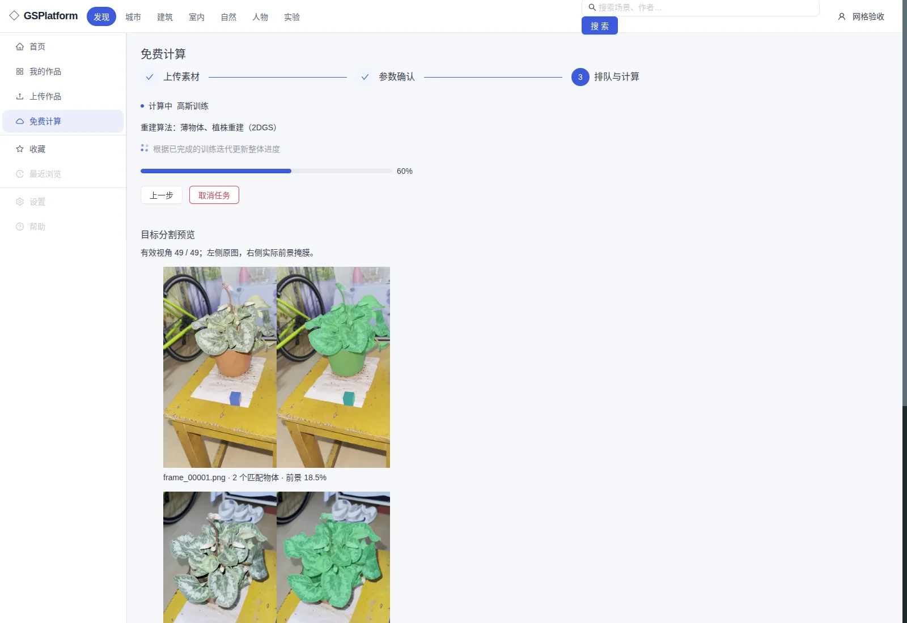
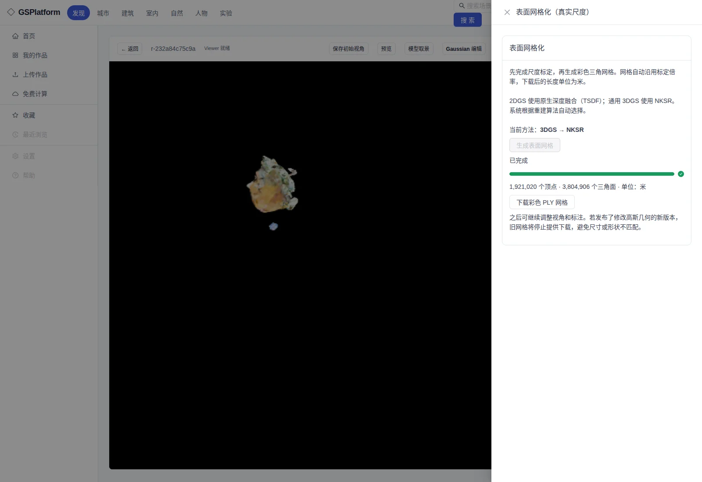

# GS-MESH-07：照片到米制表面网格验收

2026-11-14，在用户实际使用的 `http://localhost:5174` 完成验收。沿用该入口的数据库、登录会话机制和素材目录；没有切换到独立的标定预览环境。使用新建私有验收账号操作，没有重置原账号密码。

## 使用路径

登录 → 侧栏「免费计算」(`/compute`) → 上传多视角照片 → 参数确认 → 选择 gsplat/3DGS 或 2DGS → 输入保留目标的提示词 → 提交计算 → 自动进入 Edit → 首先「尺度标定」并自动发布 →「表面网格化」→ 下载米制彩色 PLY 网格。

要标定的方块必须包含在分割提示词里，例如 `potted plant; blue cube`。标准、高精度档位为 30,000 次迭代，草稿为 1,200 次；本轮两次新建全流程任务使用草稿，以验收自动衔接。另使用已有最终 30,000 次 3DGS 检查点实际生成了 NKSR 网格。不能把草稿验收结果当作 30,000 次重建质量对比。

## 实际运行结果

| 路径 | 重建 / 网格任务 | 结果 |
| --- | --- | --- |
| 2DGS + SAM3 → 自动标定 → 原生 TSDF | `dd4e2b5b-1730-4b93-82cb-348758f4c6c5` / `e9a81c48-cf09-44bd-bf2d-a7fab25c9485` | 49 张照片全部实际上传；49 个有效掩膜；38,469 Gaussian；1,351,107 网格顶点、2,537,575 三角面；101,895,260 字节 |
| gsplat/3DGS + SAM3 → 自动标定 → NKSR | `d223da6f-f97c-4748-bd4b-996b880bea98` / `a8614268-9e59-4d67-bf6c-a0baa71d9bd7` | 复用同一账号已上传的 49 张照片，经真实认证接口提交并在页面查看；40,912 Gaussian；1,921,020 网格顶点、3,804,906 三角面；147,436,126 字节 |

两条路径均在浏览器完成自动标定、网格生成和文件下载；下载文件 SHA256 与服务端结果完全一致。Open3D 独立重读两个下载文件，确认顶点/面数、有限坐标、顶点颜色和包围盒匹配。输入示例为模型距离 0.25、实际长度 20 mm，倍率 0.08；独立三角形文件重读测量为 0.02 m。示例只验证倍率和米制输出，不声称照片中的方块已获得独立物理尺寸真值。

标定后保存初始视角，再刷新页面，网格仍可下载。新增手动「模型取景」方便定位小模型，此操作不保存编辑，也不提前锁定标定。既有自动初始相机策略测试保持通过。

原有 building（`u-06924576399e`）的当前版本仍为 `01c63c7c-8eb5-498e-bcc0-77215e92ca12`、资源版本 `da7bf4207044`，校验索引 SHA256 与此前保留结果一致，拥有者账号仍启用且保留密码配置。

## 进度、队列与边界

重建和网格面板每 2 秒请求真实状态，刷新后可恢复任务。训练进度由真实迭代驱动，SAM3 提供已处理视角和预览；COLMAP、CUDA 初始化、TSDF 融合和 NKSR 求解仅报告可确认的阶段进度，不虚构连续百分比。NKSR 每个渲染视角均产生进度事件，求解和提取阶段分别报告 50/80%，原子发布成功才到 100%。

首次 2DGS 浏览器网格任务暴露 API 发送端缺少 GPU 路由，已补齐 API 和 worker 两端路由，并通过内存 broker 的真实投递队列测试。随后 3DGS 网格任务在 `vr00-gpu` worker 实际执行成功，含首次 CUDA 扩展编译共约 187 秒；不能将首次任务时长当作后续任务速度承诺。

网格具有拥有者鉴权、Cookie/CSRF 校验、当前版本检查、取消、执行代次和租约。几何版本变化时旧网格不再下载。仅导入高斯而没有原始相机和训练检查点的旧作品，暂不支持这条网格生成入口；查看与编辑能力仍保留。场景展示层的世界变换不写入网格。

## 自动检查

- 后端与 worker 相关回归：54 项通过（独立测试数据库）。覆盖标定优先、版本变化、权限、取消竞态、发布隔离、算法选择与 GPU 队列投递。
- 前端相关回归：4 个文件、38 项通过，包含重建、自动标定、网格面板、初始相机策略。
- Web 生产构建、类型检查及 Oxlint 通过；构建保留已有大分包提示。
- 新 API 模块严格 Mypy 通过；新增模块及修改路径 Ruff 通过。未声称全仓库历史 lint 问题已清理。
- 浏览器最终无 `pageerror`。原账号密码未知，因此没有声称用原密码完成登录；验收账号使用真实登录流程。

证据：[下载文件独立检查](gs-mesh07-evidence/browser-independent-verification.json)、[2DGS 结果](gs-mesh07-evidence/browser-mesh-result.json)、[NKSR 结果](gs-mesh07-evidence/gsplat-mesh-result.json)、[真实进度与 GPU 接收记录](gs-mesh07-evidence/progress-evidence.json)、[后端检查](gs-mesh07-evidence/regression-final.txt)、[前端检查](gs-mesh07-evidence/web-regression.txt)。大型 PLY、环境文件、会话和账号凭据仅保存在本机私有验收目录，未纳入仓库。

实现依据为本机现有官方 2DGS/NKSR 源码及 Context7 查询到的 gsplat 深度渲染、Celery producer 路由文档。博查搜索返回 HTTP 403；运行结论依据本地代码和实际验收，没有用搜索结果替代运行证明。详细操作与环境见 [使用说明](../surface-meshing.md)。
