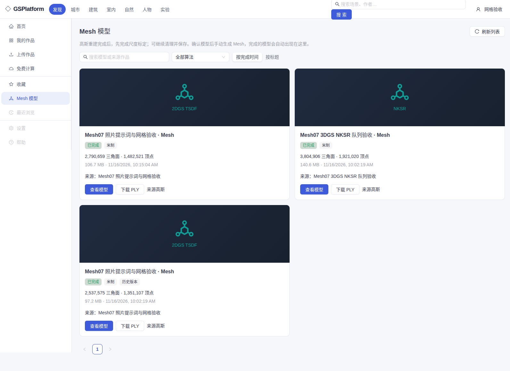
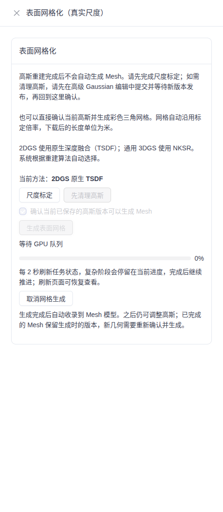
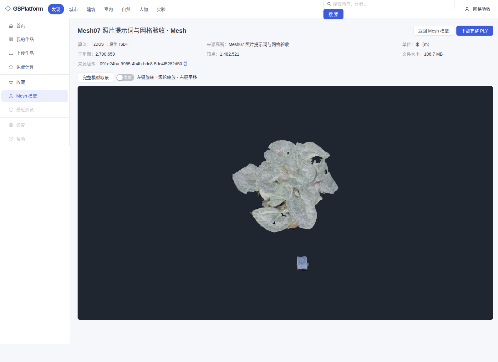

# Mesh 模型库与确认后生成验收

日期：2026-11-16。功能提交 `7e041fa`；正式入口继续为 `http://localhost:5174`，API、账号、数据库、存储和队列沿用原托管环境。

收藏下方新增 **Mesh 模型**，地址 `/meshes`。完成结果采用独立 MeshModel 记录，包含所有者、来源作品及不可变 SceneVersion、生成任务、算法、单位、顶点/面数、SHA256 和私有存储键。列表支持搜索、算法筛选、排序和分页；详情实际加载完整 PLY，可旋转、缩放、平移、切换线框并下载完整文件。历史结果保留其来源版本，作品更新后显示“历史版本”。

高斯重建完成后不自动开始网格化。使用路径为：**我的作品 → 生成 Mesh → 先完成尺度标定 → 可选“先清理高斯”并提交保存 → 勾选确认当前版本 → 生成表面网格 → 查看 Mesh 模型**。高级编辑发布成功后新增“确认此版本并生成 Mesh”入口。任务每 2 秒刷新真实阶段、进度，支持取消；成功时在同一数据库事务中完成入库。3DGS 使用 NKSR，2DGS 使用原生 TSDF。

确认与任务均绑定当前已保存的几何版本；编辑正在上传或发布时禁止启动。服务沿已完成的编辑会话追溯标定和原始重建，解码当前保存的高斯，撤销一次标定倍率以复用原相机坐标，网格写出时再应用倍率。2DGS 恢复原生双尺度 surfel 参数后重新融合；3DGS 使用当前 PLY 属性重新渲染深度与法向。清理分支不套用可能裁掉移动对象的旧图像掩膜。任务执行期间版本变化或取消会阻止发布。无来源的导入高斯仍会说明缺少原始相机资料。

## 原有全量结果

此前完成的两份全量 Mesh 已校验并登记在原账号下，其原始文件、来源高斯版本均保持不变。原素材 250 张，其中可解码 247 张；最终各训练 30,000 次。原始模型尚未完成实际尺寸标定，因此这两份历史结果明确显示“未标定尺度”，不能当作米制使用。

| 结果 | 配准训练视角 | 三角面 | 模型详情 |
| --- | ---: | ---: | --- |
| gsplat → NKSR | 242 | 573,486 | `/meshes/88fbd571-69de-5d89-89f9-fec55b4d66b8` |
| 2DGS → TSDF | 246 | 2,675,832 | `/meshes/f5b98fef-cc93-56e8-b5b8-7defe0d5ecb4` |

[回填记录](gs-mesh10-evidence/backfill-full.json)包含文件校验和。已有成功 BUILD_MESH 任务也已通过 `scripts/backfill_mesh_models.py --apply` 幂等登记。该脚本默认只校验并展示计划。

## 实际验证

隔离数据库中 **40 项 API/worker 检查通过**，包含权限隔离、CSRF、当前版本绑定、清理链溯源、拒绝未完成/无关编辑、取消及版本竞态、重复执行和入库幂等、历史 Mesh 下载，以及真实官方转换器的坐标与尺度数值检查。前端完整套件 **519 项通过**；随后定向 **6 项通过**，其中新增 2 项模型库检查。类型检查、前端 lint/构建、相关 Python Ruff、模型库新接口 Mypy 通过。

另外复用两份全量 30,000 次产物进行实际清理几何回归。在临时副本中按 Y 的 P99 删除尾部高斯，乘以测试倍率 0.08，再走当前几何解码与网格化。两条路径均使用全部配准视角；原用户模型没有被这些回归副本替换。这一测试验证几何与倍率处理，测试倍率不代表测得的真实物理尺寸。

| 路径 | 原高斯数 | 清理后输入数 | 全部配准视角 | 生成三角面 |
| --- | ---: | ---: | ---: | ---: |
| gsplat → NKSR | 600,103 | 594,101 | 242 | 705,214 |
| 2DGS → TSDF | 375,688 | 371,931 | 246 | 2,786,491 |

[gsplat 数值与产物记录](gs-mesh10-evidence/gsplat-full-cleaned-verification.json)、[2DGS 数值与产物记录](gs-mesh10-evidence/2dgs-full-cleaned-verification.json)。本轮未重跑训练。

浏览器使用 Chrome 145，在原 5174 中通过正常登录使用既有独立验收账号。完成列表与详情、线框、下载、空搜索、历史版本及 412px 手机页面检查，无横向溢出。实际操作官方 SuperSplat Editor 删除 **47** 个高斯，导出并提交，发布版本从 38,469 点变为 **38,422** 点；确认按钮在勾选前不可提交。点击生成后真实 GPU 任务约 86 秒完成，生成 **2,790,659** 面，自动入库并通过新详情预览。该浏览器流程使用既有 49 张照片的功能验收作品；本轮全量几何回归及提供原账号查看的两份正式效果结果使用上表的 247 张可解码素材。

浏览器下载的旧、新两份完整 Mesh 由 Open3D 独立重读，顶点/面数、有限坐标、颜色、包围盒与 SHA256 均匹配。[下载核查](gs-mesh10-evidence/independent-download-verification.json)。[浏览器记录](gs-mesh10-evidence/browser-check.json)中页面脚本错误为零；记录了 1 次官方编辑器来源请求的 `ERR_ABORTED`，编辑器实际完成加载、导出、提交与发布。

原 building 的 ID、拥有者、当前版本和资源索引 SHA256 与本轮前一致；[原环境及来源核查](gs-mesh10-evidence/environment-and-provenance-verification.json)。本轮仅添加模型表、记录和私有文件副本；未修改原账号密码，未将测试数据库接到用户入口。

## 后续接口

- `GET /api/v1/mesh-models`：本人完成的 Mesh，支持 `q`、`algorithm`、`sort`、`page`、`pageSize`。
- `GET /api/v1/mesh-models/{id}`：模型与来源版本元数据。
- `GET /api/v1/mesh-models/{id}/file`：鉴权完整 PLY 下载，私有且不缓存。

接口复用当前登录会话；其他账号及删除作品的模型不可读取。此版本网格预览加载完整文件，大模型的浏览器内存开销随面数增加。

结论来源为仓库实现、原环境数据库/文件、真实 GPU 执行和浏览器验收。博查搜索返回 HTTP 403，搜索不可用；库接口另核对了 Context7 获取的 [Three.js 官方 PLYLoader 文档](https://threejs.org/docs/#examples/en/loaders/PLYLoader)。没有使用搜索或模型记忆替代本地运行结果。
